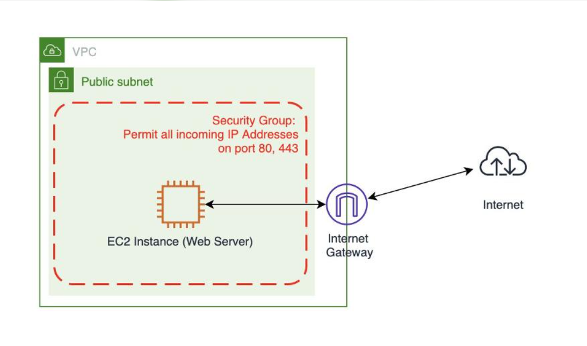

**# AWS EC2 RUNNING BUT WEBSITE IS UNREACHABLE – CAUSES AND SOLUTIONS**

During application deployment on AWS, a common issue is that an EC2 Instance shows the `Running` status, but users are still unable to access the website through its Public IPv4 Address.

The problem may originate from network configurations, access permissions, or the Web Server service running inside the instance.

The following are some common causes and solutions to consider:

* **Public IPv4 Address:** The EC2 instance has not been assigned a Public IPv4 Address, so it cannot be accessed directly from the Internet. Check and ensure that the instance has an appropriate Public IPv4 Address.

* **Security Group:** Inbound traffic for HTTP (TCP 80) or HTTPS (TCP 443) has not been allowed. Add appropriate Inbound Rules to permit users to access the website.

* **Internet Gateway:** The VPC is not attached to an Internet Gateway, or the Internet connectivity route has not been configured. Check whether the Internet Gateway is attached to the VPC.

* **Route Table:** The subnet does not have a default route `0.0.0.0/0` pointing to the Internet Gateway. Add the appropriate route to allow traffic to reach the Internet.

* **Network ACL:** Inbound and Outbound rules may be blocking network traffic. Check the rules and allow the required traffic, including ephemeral ports used for response connections.

* **Web Server:** Nginx or Apache has not been installed or the service is not running. Check the service status using the command `sudo systemctl status nginx`.

* **Ubuntu Firewall:** UFW may be blocking HTTP/HTTPS connections. Check the firewall status and allow the required service ports.

**# TROUBLESHOOTING AND SOLUTION PROCESS**

To resolve the issue, follow these steps in order:

1. Check the EC2 Public IPv4 Address.
2. Check the Inbound Rules in the Security Group.
3. Verify that the Internet Gateway is attached to the VPC.
4. Check the Subnet's Route Table.
5. Review the Network ACL configuration.
6. Check whether Nginx or Apache is running.
7. Check the firewall configuration on the operating system.

After completing the troubleshooting and configuration steps, access the following address:

`http://<PUBLIC-IP-EC2>`

If all components are configured correctly and Nginx is running, the website should be accessible through a web browser.

**# LESSONS LEARNED**

An EC2 Instance being in the `Running` state does not necessarily mean that the application inside it is ready to serve users.

When deploying systems on AWS, multiple components must be checked together, including Compute, Networking, Security, and Application.

Understanding the relationships between EC2, VPC, Subnet, Route Table, Internet Gateway, and Security Group will make troubleshooting more effective and help minimize service downtime.

[Tên hiển thị của liên kết](https://example.com)

...Guide...