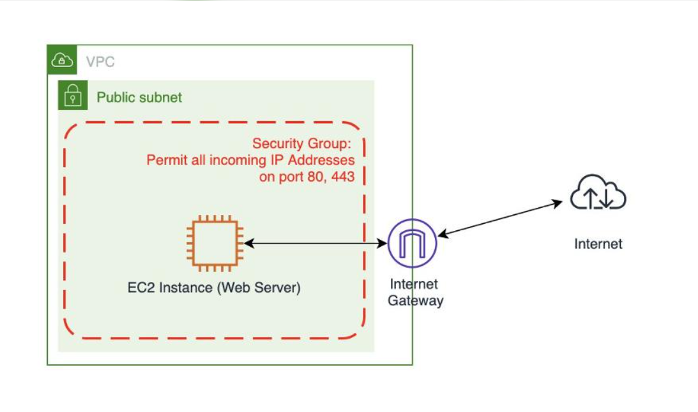

**# AWS EC2 RUNNING NHƯNG WEBSITE KHÔNG THỂ TRUY CẬP – NGUYÊN NHÂN VÀ CÁCH KHẮC PHỤC**

Trong quá trình triển khai ứng dụng trên AWS, một tình huống khá phổ biến là EC2 Instance đã ở trạng thái `Running` nhưng người dùng vẫn không thể truy cập website thông qua Public IPv4 Address.

Nguyên nhân có thể xuất phát từ cấu hình mạng, quyền truy cập hoặc dịch vụ Web Server bên trong máy chủ.

Các nguyên nhân và giải pháp cần lưu ý:

* **Public IPv4 Address:** EC2 chưa được gán địa chỉ Public IPv4 nên không thể truy cập trực tiếp từ Internet. Cần kiểm tra và đảm bảo Instance có Public IPv4 Address phù hợp.

* **Security Group:** Chưa cho phép lưu lượng HTTP (TCP 80) hoặc HTTPS (TCP 443). Cần bổ sung các quy tắc Inbound phù hợp để cho phép người dùng truy cập website.

* **Internet Gateway:** VPC chưa được gắn Internet Gateway hoặc chưa cấu hình tuyến đường kết nối Internet. Cần kiểm tra Internet Gateway đã được Attach với VPC hay chưa.

* **Route Table:** Subnet chưa có tuyến mặc định `0.0.0.0/0` trỏ đến Internet Gateway. Cần bổ sung tuyến đường phù hợp để cho phép lưu lượng ra Internet.

* **Network ACL:** Các quy tắc Inbound và Outbound có thể đang chặn kết nối. Cần kiểm tra và cho phép lưu lượng cần thiết, bao gồm cả các cổng ephemeral phục vụ kết nối phản hồi.

* **Web Server:** Dịch vụ Nginx hoặc Apache chưa được cài đặt hoặc chưa hoạt động. Có thể kiểm tra trạng thái dịch vụ bằng lệnh `sudo systemctl status nginx`.

* **Firewall trên Ubuntu:** UFW có thể đang chặn kết nối HTTP/HTTPS. Cần kiểm tra trạng thái firewall và cho phép các cổng dịch vụ cần thiết.

**# QUY TRÌNH KIỂM TRA VÀ KHẮC PHỤC**

Để xử lý sự cố, có thể thực hiện theo thứ tự:

1. Kiểm tra Public IPv4 Address của EC2.
2. Kiểm tra Inbound Rules trong Security Group.
3. Kiểm tra Internet Gateway đã được gắn với VPC.
4. Kiểm tra Route Table của Subnet.
5. Kiểm tra Network ACL.
6. Kiểm tra trạng thái hoạt động của Nginx hoặc Apache.
7. Kiểm tra Firewall trên hệ điều hành.

Sau khi hoàn tất các bước kiểm tra và khắc phục, truy cập địa chỉ:

`http://<PUBLIC-IP-EC2>`

Nếu các thành phần được cấu hình chính xác và Nginx đang hoạt động, website sẽ có thể truy cập từ trình duyệt.

**# BÀI HỌC KINH NGHIỆM**

Một EC2 Instance ở trạng thái `Running` không đồng nghĩa với việc ứng dụng bên trong đã sẵn sàng phục vụ người dùng.

Khi triển khai hệ thống trên AWS, cần kiểm tra đồng thời nhiều thành phần như Compute, Networking, Security và Application.

Việc hiểu rõ mối liên hệ giữa EC2, VPC, Subnet, Route Table, Internet Gateway và Security Group sẽ giúp quá trình Troubleshooting hiệu quả hơn, đồng thời hạn chế thời gian gián đoạn dịch vụ.

[Tên hiển thị của liên kết](https://example.com)

...Hướng dẫn...