---
title: "Cấu hình VPN Site-to-Site kết nối mạng doanh nghiệp đa chi nhánh"
date: 2026-10-31
weight: 5
chapter: false
pre: " <b> 4.5. </b> "
---

### Tổng quan

Trong phần này, chúng ta sẽ cấu hình kết nối AWS Site-to-Site VPN nhằm kết nối an toàn mạng doanh nghiệp nội bộ được mô phỏng trên EVE-NG với môi trường điện toán đám mây AWS.

Giải pháp sử dụng Virtual Private Gateway (VGW) trên AWS được gắn với Hybrid Cloud VPC và Customer Gateway đại diện cho thiết bị VPN tại mạng doanh nghiệp. Các đường hầm IPsec VPN cung cấp kết nối được mã hóa giữa hai môi trường.

Mạng doanh nghiệp bao gồm mạng tại trụ sở chính và các chi nhánh. Kết nối VPN cho phép các mạng nội bộ được cấp quyền giao tiếp với tài nguyên được triển khai trong AWS VPC.

### 1. Chuẩn bị môi trường VPN

Trước khi tạo kết nối VPN, cần kiểm tra và chuẩn bị các tài nguyên, thông tin sau:

- AWS VPC đã được tạo.
- Virtual Private Gateway (VGW) đã được gắn với VPC.
- Địa chỉ IP public có thể được AWS truy cập của thiết bị VPN tại mạng doanh nghiệp.
- Các dải địa chỉ CIDR của mạng nội bộ.
- Dải địa chỉ CIDR của AWS VPC.
- Router hoặc thiết bị VPN tại EVE-NG đang hoạt động.

Trong dự án này, AWS VPC sử dụng dải địa chỉ `10.100.0.0/16`. Các dải mạng nội bộ cần được khai báo theo đúng cấu hình thực tế của hệ thống doanh nghiệp.

**Hình 4.5.1: AWS VPC và Virtual Private Gateway**

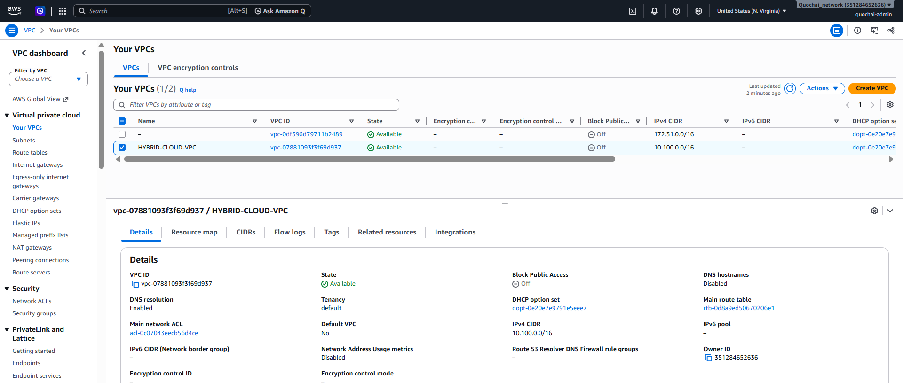

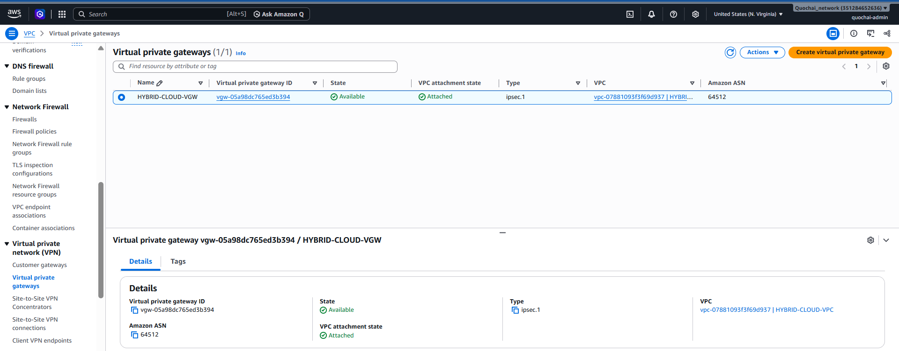

### 2. Tạo Customer Gateway

Customer Gateway đại diện cho thiết bị VPN tại mạng doanh nghiệp trong hệ thống AWS.

1. Truy cập AWS Management Console.
2. Mở dịch vụ **VPC**.
3. Trong thanh điều hướng, chọn **Customer Gateways**.
4. Nhấn **Create customer gateway**.
5. Nhập tên mô tả, ví dụ: `HYBRID-CLOUD-CGW`.
6. Chọn phương thức định tuyến phù hợp. Trong bài thực hành này, chọn định tuyến tĩnh nếu hệ thống sử dụng static routing.
7. Chỉ khai báo BGP ASN nếu sử dụng định tuyến động BGP.
8. Nhập địa chỉ IP public có thể được AWS truy cập của thiết bị VPN tại mạng doanh nghiệp.
9. Nhấn **Create customer gateway** để hoàn tất.


**Hình 4.5.2: Tạo Customer Gateway**

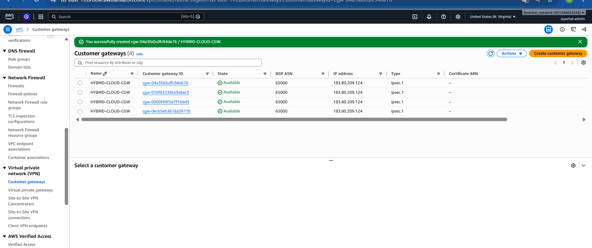

### 3. Tạo kết nối Site-to-Site VPN

Sau khi tạo Customer Gateway, tiến hành tạo kết nối VPN.

1. Trong giao diện VPC, chọn **Site-to-Site VPN Connections**.
2. Nhấn **Create VPN connection**.
3. Nhập tên kết nối, ví dụ: `HYBRID-CLOUD-S2S-VPN`.
4. Chọn Virtual Private Gateway đã tạo và gắn với VPC.
5. Chọn Customer Gateway vừa tạo.
6. Chọn phương thức định tuyến phù hợp với cấu hình mạng nội bộ.
7. Nếu sử dụng định tuyến tĩnh, khai báo các dải CIDR của mạng doanh nghiệp.
8. Kiểm tra lại cấu hình và nhấn **Create VPN connection**.

AWS sẽ tạo hai đường hầm IPsec VPN cho kết nối. Hai đường hầm này cung cấp các đường kết nối thay thế giữa mạng nội bộ và AWS.

**Hình 4.5.3: Tạo kết nối Site-to-Site VPN**

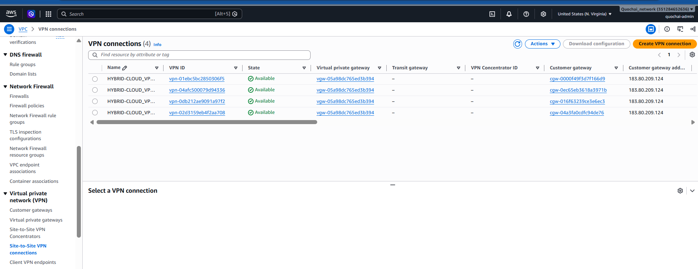

### 4. Cấu hình VPN Tunnel trên Router mạng nội bộ

Sử dụng tệp cấu hình tải từ AWS làm tài liệu tham khảo để cấu hình router tại EVE-NG.

Cấu hình cần đảm bảo các thông số trùng khớp với thông tin AWS cung cấp, bao gồm:

- Địa chỉ IP outside tunnel.
- Địa chỉ IP inside tunnel.
- Pre-shared key.
- Phiên bản IKE và phương thức xác thực.
- Thuật toán mã hóa và kiểm tra tính toàn vẹn.
- Diffie-Hellman group.
- Thời gian tồn tại của IPsec SA và các tham số liên quan.

Tiến hành cấu hình cả hai đường hầm VPN do AWS cung cấp trên thiết bị VPN mạng nội bộ phù hợp.


**Hình 4.5.4: Cấu hình IPsec VPN trên Router EVE-NG**

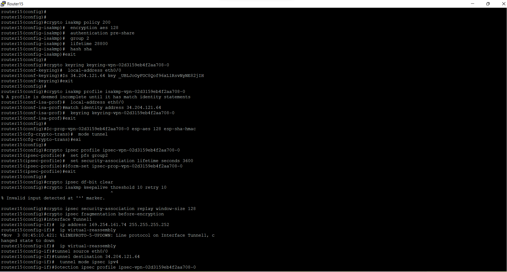
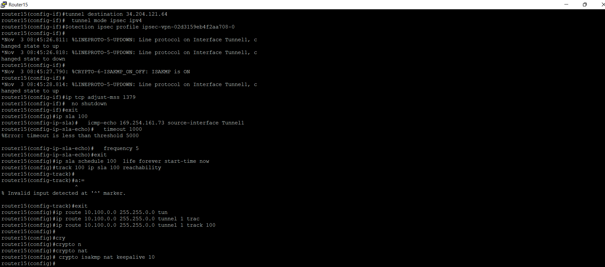
### 5. Cấu hình định tuyến giữa mạng nội bộ và AWS

Để hai môi trường có thể giao tiếp với nhau, cần cấu hình định tuyến ở cả hai phía.

**Trên AWS:**

1. Mở giao diện VPC.
2. Chọn **Route Tables**.
3. Mở route table gắn với các subnet cần giao tiếp với mạng nội bộ.
4. Chọn **Edit routes**.
5. Thêm các dải CIDR của mạng doanh nghiệp.
6. Chọn Virtual Private Gateway làm target.
7. Lưu cấu hình.

**Trên mạng nội bộ:**

1. Cấu hình route đến dải mạng AWS VPC `10.100.0.0/16`.
2. Chỉ định next hop hoặc tunnel interface theo thiết kế VPN.
3. Kiểm tra các router nội bộ có thể chuyển tiếp lưu lượng đến thiết bị VPN.

Đảm bảo các dải CIDR của mạng nội bộ không bị trùng lặp với dải CIDR của AWS VPC.

**Hình 4.5.5: Cấu hình Route Table trên AWS**

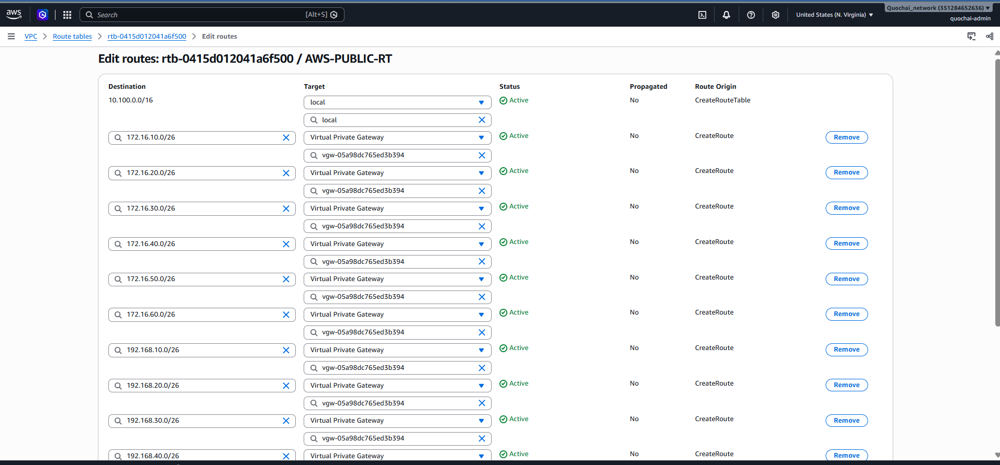

**Hình 4.5.6: Cấu hình định tuyến trên Router mạng nội bộ**

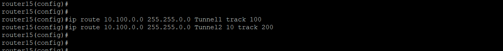

### 6. Kiểm tra trạng thái VPN Tunnel

Sau khi hoàn tất cấu hình, tiến hành kiểm tra trạng thái hoạt động của các VPN Tunnel.

1. Mở **Site-to-Site VPN Connections** trong giao diện VPC.
2. Chọn kết nối VPN vừa tạo.
3. Mở tab **Tunnel details**.
4. Kiểm tra trạng thái của cả hai tunnel.
5. Xác nhận tunnel hoạt động có trạng thái **UP**.

Trên router EVE-NG, sử dụng các câu lệnh phù hợp để kiểm tra IKE, IPsec Security Associations và trạng thái tunnel interface.

Ví dụ các câu lệnh kiểm tra trên Cisco IOS:

```bash
show crypto isakmp sa
show crypto ipsec sa
show interface tunnel
show ip route
```

Các câu lệnh cụ thể có thể thay đổi tùy theo nền tảng router và cấu hình VPN.

**Hình 4.5.7: Trạng thái VPN Tunnel trên AWS**

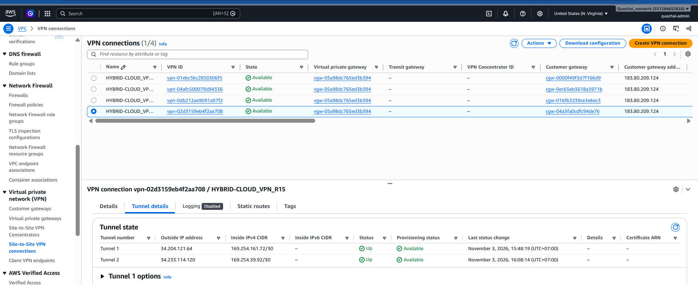

**Hình 5.5.8: Kiểm tra trạng thái IPsec trên Router**

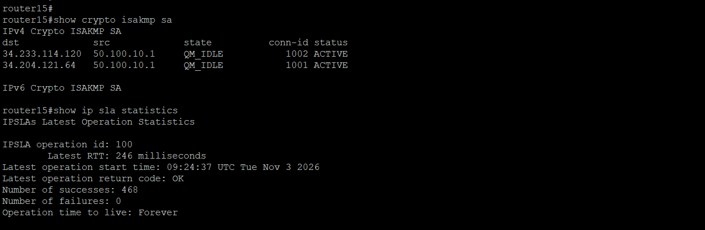
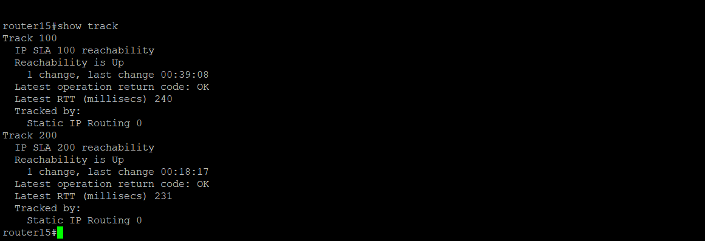

### Kết luận

Trong phần này, chúng ta đã tạo Customer Gateway và kết nối Site-to-Site VPN trên AWS, cấu hình các đường hầm IPsec trên thiết bị VPN mạng nội bộ và thiết lập định tuyến giữa mạng doanh nghiệp với AWS VPC.

Kết nối VPN cung cấp đường truyền được mã hóa giữa hạ tầng mạng nội bộ và môi trường điện toán đám mây. Trong phần tiếp theo, chúng ta sẽ cấu hình định tuyến và cơ chế dự phòng VPN nhằm nâng cao tính sẵn sàng của kết nối.
