---
title: "Deploy a centralized monitoring system using Prometheus and Grafana, along with an Amazon S3 backup service."
date: 2026-11-01
weight: 7
chapter: false
pre: " <b> 4.7. </b> "
---

### Overview

In this section, we will deploy a centralized monitoring solution to monitor the performance and resource utilization of the cloud server in the Hybrid Cloud environment.

The monitoring system is deployed on an Ubuntu 24.04 EC2 instance and consists of three main components:

- **Prometheus:** Collects and stores time-series monitoring metrics.
- **Node Exporter:** Exposes Linux server metrics, including CPU, memory, disk, and network information.
- **Grafana:** Visualizes monitoring data through dashboards and charts.

The components work together to help administrators observe server performance, identify resource usage trends, and detect potential infrastructure issues.

### 1. Prepare the Monitoring Environment

Before installing the monitoring components, connect to the EC2 instance using SSH.

Use the following command from your local terminal:

```bash
ssh -i "hybrid-cloud-webserver-key.pem" ubuntu@44.203.161.19
```

`44.203.161.19` is the current public IPv4 address of the EC2 instance.

Update the Ubuntu package index:

```bash
sudo apt update
sudo apt upgrade -y
```

Check the operating system version:

```bash
lsb_release -a
```

Confirm that the instance is running Ubuntu 24.04.

**Image 4.7.1: Connect to the EC2 Instance**

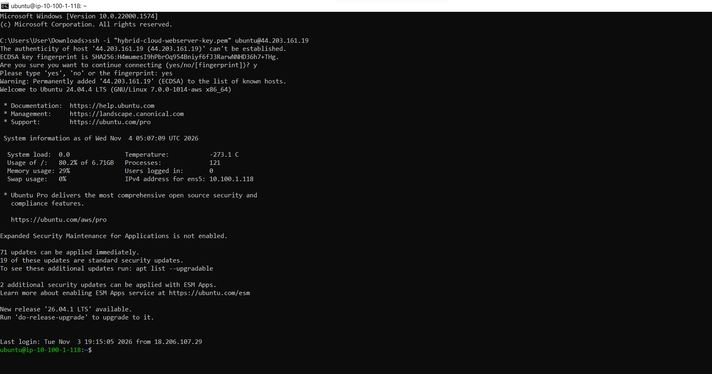
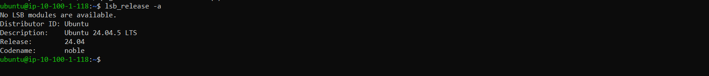

### 2. Install Node Exporter

Node Exporter collects hardware and operating system metrics from Linux servers and exposes them for Prometheus to scrape.

Create a dedicated system user:

```bash
sudo useradd --no-create-home --shell /usr/sbin/nologin node_exporter
```

Download and extract Node Exporter:

```bash
cd /tmp

wget https://github.com/prometheus/node_exporter/releases/download/v1.7.0/node_exporter-1.7.0.linux-amd64.tar.gz

tar xvf node_exporter-1.7.0.linux-amd64.tar.gz
```

Install the executable:

```bash
sudo cp node_exporter-1.7.0.linux-amd64/node_exporter /usr/local/bin/

sudo chown node_exporter:node_exporter /usr/local/bin/node_exporter
```

Create a systemd service:

```bash
sudo nano /etc/systemd/system/node_exporter.service
```

Add the following configuration:

```ini
[Unit]
Description=Node Exporter
After=network.target

[Service]
User=node_exporter
Group=node_exporter
Type=simple
ExecStart=/usr/local/bin/node_exporter

[Install]
WantedBy=multi-user.target
```

Save the file and start the service:

```bash
sudo systemctl daemon-reload
sudo systemctl enable --now node_exporter
```

Check the service status:

```bash
sudo systemctl status node_exporter
```

Node Exporter uses TCP port `9100` by default.

**Image 4.7.2: Node Exporter Installation and Service Status**

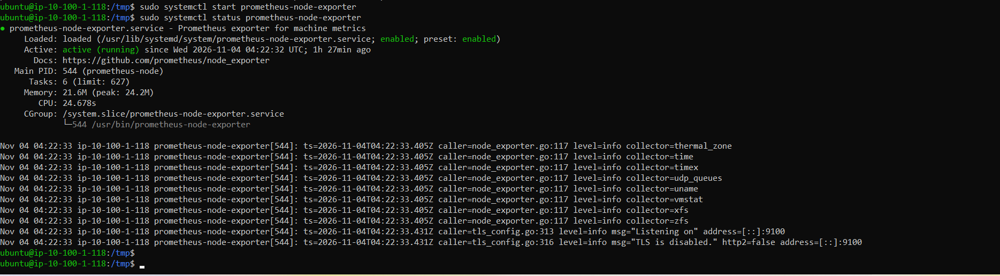

### 3. Install Prometheus

Prometheus is responsible for collecting and storing monitoring metrics from Node Exporter.

Create a dedicated system user and required directories:

```bash
sudo useradd --no-create-home --shell /usr/sbin/nologin prometheus

sudo mkdir -p /etc/prometheus

sudo mkdir -p /var/lib/prometheus
```

Download and extract Prometheus:

```bash
cd /tmp

wget https://github.com/prometheus/prometheus/releases/download/v2.54.1/prometheus-2.54.1.linux-amd64.tar.gz

tar xvf prometheus-2.54.1.linux-amd64.tar.gz
```

Copy the required files:

```bash
sudo cp prometheus-2.54.1.linux-amd64/prometheus /usr/local/bin/

sudo cp prometheus-2.54.1.linux-amd64/promtool /usr/local/bin/

sudo cp -r prometheus-2.54.1.linux-amd64/consoles /etc/prometheus/

sudo cp -r prometheus-2.54.1.linux-amd64/console_libraries /etc/prometheus/
```

Set the appropriate ownership:

```bash
sudo chown prometheus:prometheus /usr/local/bin/prometheus

sudo chown prometheus:prometheus /usr/local/bin/promtool

sudo chown -R prometheus:prometheus /etc/prometheus

sudo chown -R prometheus:prometheus /var/lib/prometheus
```

### 4. Configure Prometheus

Create the Prometheus configuration file:

```bash
sudo nano /etc/prometheus/prometheus.yml
```

Add the following configuration:

```yaml
global:
  scrape_interval: 15s

scrape_configs:
  - job_name: "prometheus"
    static_configs:
      - targets: ["localhost:9090"]

  - job_name: "node_exporter"
    static_configs:
      - targets: ["localhost:9100"]
```

This configuration defines two monitoring targets:

- `localhost:9090`: Prometheus monitors its own metrics.
- `localhost:9100`: Prometheus collects Linux server metrics from Node Exporter.

Set the configuration file ownership:

```bash
sudo chown prometheus:prometheus /etc/prometheus/prometheus.yml
```

Create a systemd service:

```bash
sudo nano /etc/systemd/system/prometheus.service
```

Add:

```ini
[Unit]
Description=Prometheus Monitoring
Wants=network-online.target
After=network-online.target

[Service]
User=prometheus
Group=prometheus
Type=simple
ExecStart=/usr/local/bin/prometheus \
  --config.file=/etc/prometheus/prometheus.yml \
  --storage.tsdb.path=/var/lib/prometheus/ \
  --web.listen-address=0.0.0.0:9090

[Install]
WantedBy=multi-user.target
```

Start and enable Prometheus:

```bash
sudo systemctl daemon-reload

sudo systemctl enable --now prometheus
```

Check the service:

```bash
sudo systemctl status prometheus
```


**Image 4.7.3: Prometheus Service Status**

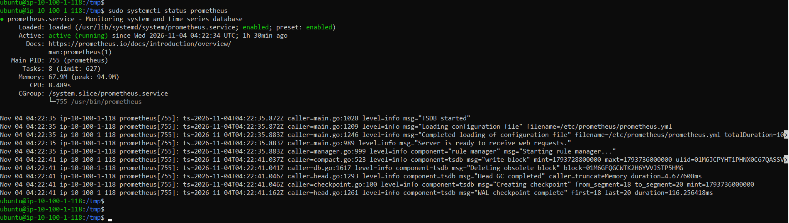

### 5. Verify Prometheus Targets

Open the following address in a web browser:

```text
http://44.203.161.19:9090/classic/targets
```

`44.203.161.19` is the current public IPv4 address of the EC2 instance.

The Targets page should display the configured monitoring endpoints.

Verify that both targets have the status **UP**:

- `prometheus`
- `node_exporter`

If a target is DOWN, check the corresponding service and Prometheus configuration.

**Image 4.7.4: Prometheus Targets Status**

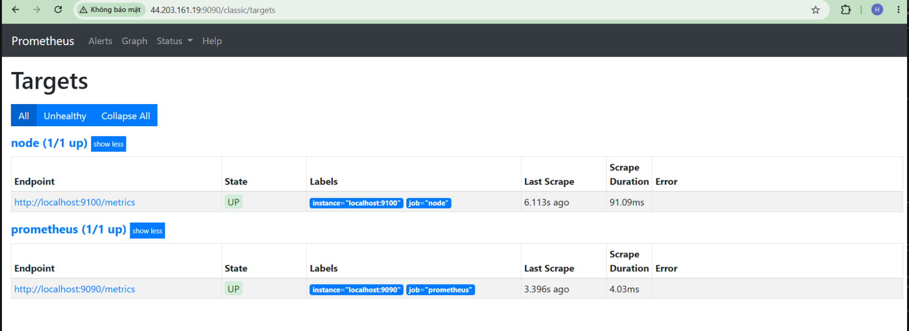

### 6. Install Grafana

Grafana provides dashboards for visualizing the metrics collected by Prometheus.

Install the required packages:

```bash
sudo apt-get install -y apt-transport-https software-properties-common wget
```

Create the keyrings directory:

```bash
sudo mkdir -p /etc/apt/keyrings
```

Add the Grafana package signing key:

```bash
wget -q -O - https://apt.grafana.com/gpg.key | gpg --dearmor | sudo tee /etc/apt/keyrings/grafana.gpg > /dev/null
```

Add the Grafana repository:

```bash
echo "deb [signed-by=/etc/apt/keyrings/grafana.gpg] https://apt.grafana.com stable main" | sudo tee /etc/apt/sources.list.d/grafana.list
```

Update the package index and install Grafana:

```bash
sudo apt-get update

sudo apt-get install -y grafana
```

Enable and start Grafana:

```bash
sudo systemctl enable --now grafana-server
```

Check the service status:

```bash
sudo systemctl status grafana-server
```

Grafana uses TCP port `3000` by default.

**Image 4.7.5: Grafana Installation and Service Status**

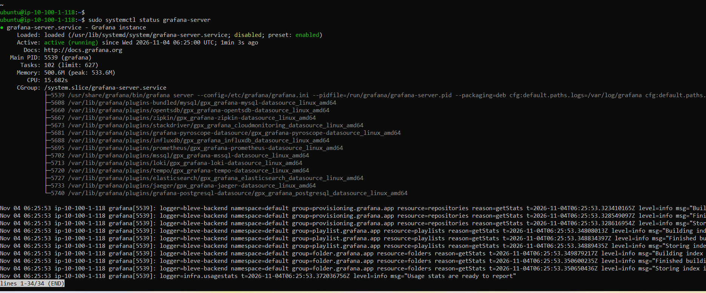

### 7. Access Grafana and Add Prometheus as a Data Source

Open Grafana in a web browser:

```text
http://44.203.161.19:3000
```

Log in using the configured administrator credentials. On a fresh installation, the default credentials are:

- Username: `admin`
- Password: `admin`

Grafana will normally require changing the default password after the first login.

To add Prometheus as a data source:

1. Open **Connections**.
2. Select **Data sources**.
3. Choose **Add data source**.
4. Select **Prometheus**.
5. Enter the Prometheus server URL:

```text
http://localhost:9090
```

6. Choose **Save & test**.

Confirm that Grafana can successfully connect to Prometheus.

**Image 4.7.6: Add Prometheus Data Source in Grafana**

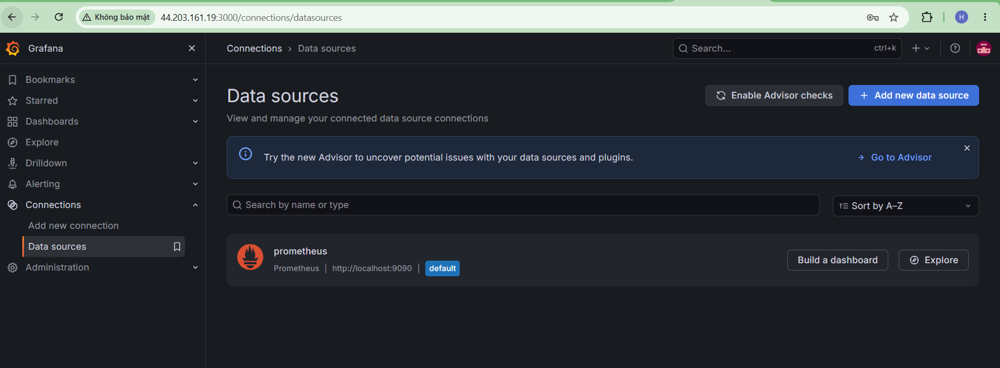

### 8. Create a Monitoring Dashboard

After adding Prometheus as a data source, create a dashboard to visualize server performance.

1. Open **Dashboards**.
2. Select **New**.
3. Choose **New dashboard**.
4. Add a visualization.
5. Select Prometheus as the data source.
6. Enter a PromQL query.
7. Save the dashboard.

Example PromQL queries:

**CPU Usage:**

```promql
100 * (1 - avg by (instance) (rate(node_cpu_seconds_total{mode="idle"}[5m])))
```

**Memory Usage:**

```promql
100 * (1 - node_memory_MemAvailable_bytes / node_memory_MemTotal_bytes)
```

**Disk Usage:**

```promql
100 * (1 - node_filesystem_avail_bytes{mountpoint="/",fstype!="tmpfs"} / node_filesystem_size_bytes{mountpoint="/",fstype!="tmpfs"})
```

**Network Receive Traffic:**

```promql
rate(node_network_receive_bytes_total{device!="lo"}[5m])
```

The dashboard can display CPU utilization, memory consumption, disk usage, and network traffic.

**Image 4.7.7: Grafana Monitoring Dashboard**

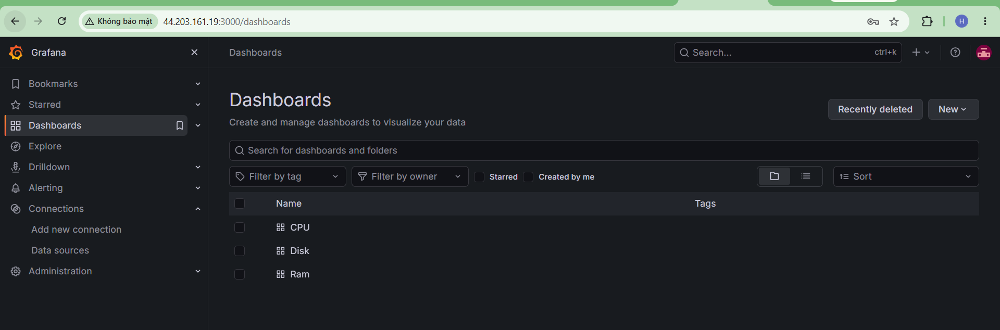


### 9. Checking the Operation of the Monitoring System

To verify that the system can collect real-time data, temporarily generate CPU, RAM, and Disk loads on the EC2 server.

Install stress-ng if it is not already installed on the server:

```bash
sudo apt update

sudo apt install -y stress-ng
```

Generate CPU load for a short period:

```bash
stress-ng --cpu 2 --timeout 60s
```

While the test is running:

1. Open the Grafana Dashboard.
2. Observe the CPU Utilization chart.
3. Check whether CPU usage increases during the test.
4. Wait for the load generation process to finish.
5. Confirm that CPU usage gradually decreases to its normal state.

Generate RAM load for a short period:

```bash
stress-ng --vm 1 --vm-bytes 200M --vm-keep --timeout 60s
```

While the test is running:

1. Observe the Memory Usage chart on Grafana.
2. Check whether RAM usage increases during the test.
3. Wait for the load generation process to finish.
4. Confirm that RAM usage gradually decreases to its normal state.

Check the current Disk capacity and generate Disk read/write activity:

```bash
df -h
stress-ng --hdd 1 --hdd-bytes 100M --timeout 60s
```

While the test is running:

1. Observe the Disk I/O chart on Grafana.
2. Check whether Disk read/write activity increases during the test.
3. Wait for the load generation process to finish.
4. Confirm that Disk activity returns to its normal state.

After the tests, verify that both monitoring targets are still displayed as UP in Prometheus.

**Image 4.7.8: Generating CPU load for monitoring testing**

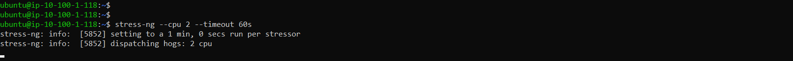

**Image 4.7.9: Monitoring CPU on Grafana**


**Image 4.7.10: Generating RAM load for monitoring testing**

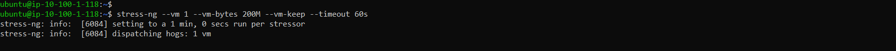

**Image 4.7.11: Monitoring RAM on Grafana**


**Image 4.7.12: Generating Disk load for monitoring testing**

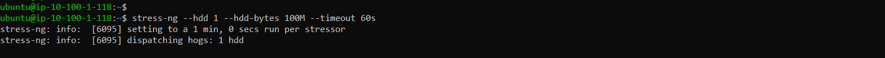

**Image 4.7.13: Monitoring Disk on Grafana**


### 10. Create AWS S3 Bucket
Access the AWS Management Console and perform the following steps:

1. Search for the S3 service.
2. Click **Create bucket**.
3. Enter a globally unique Bucket name across AWS.
4. Select the AWS Region: **US East (N. Virginia) – us-east-1**, the same region as your EC2 instance.
5. Keep Block all public access enabled.
6. Keep the remaining settings as default and **click Create bucket**.

The bucket is used exclusively for storing backups and does not require public access permissions.

**Image 4.7.14: Create bucket**

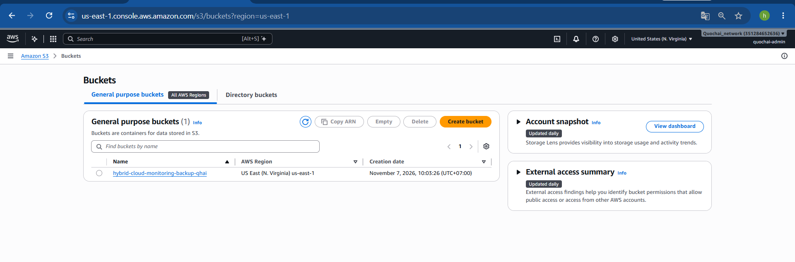


### 11. Create IAM Policy to Allow EC2 to Write Data to S3
To allow EC2 to upload backup files to the bucket, create an IAM Policy with restricted access permissions.

Go to IAM → Policies → Create policy → JSON and add the following content:

```json
{
  "Version": "2012-10-17",
  "Statement": [
    {
      "Effect": "Allow",
      "Action": [
        "s3:PutObject",
        "s3:ListBucket"
      ],
      "Resource": [
        "arn:aws:s3:::hybrid-cloud-monitoring-backup-qhai",
        "arn:aws:s3:::hybrid-cloud-monitoring-backup-qhai/*"
      ]
    }
  ]
}
```

Name the policy, for example: EC2-Monitoring-S3-Backup-Policy, then create the policy.

**Hình 4.7.15: Create IAM-Policy**

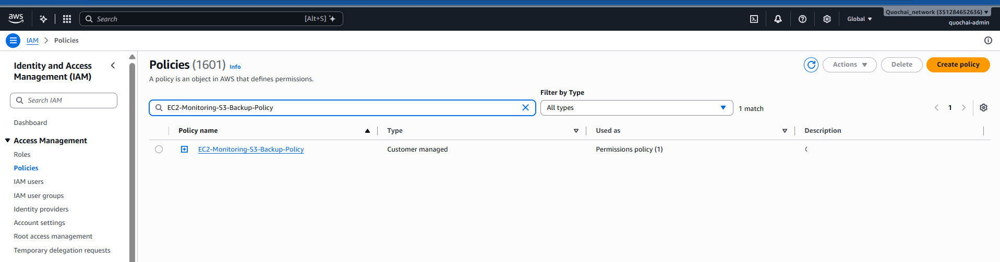

### 12. Attach IAM Role to EC2 Instance

1. Go to IAM → Roles → Create role.
2. Select AWS service.
3. Choose EC2 as the use case.
4. Attach the policy EC2-Monitoring-S3-Backup-Policy you just created.
5. Name the role, for example: EC2-Monitoring-S3-Backup-Role.
6. Complete the role creation process.
7. Go to EC2 → Instances and select the server running Prometheus and Grafana.
8. Choose Actions → Security → Modify IAM role.
9. Select the EC2-Monitoring-S3-Backup-Role role and update it.

The IAM Role allows EC2 to receive temporary credentials to access S3. There is no need to create or store Access Keys and Secret Keys on the server.

**Image 4.7.16: Create IAM Role**

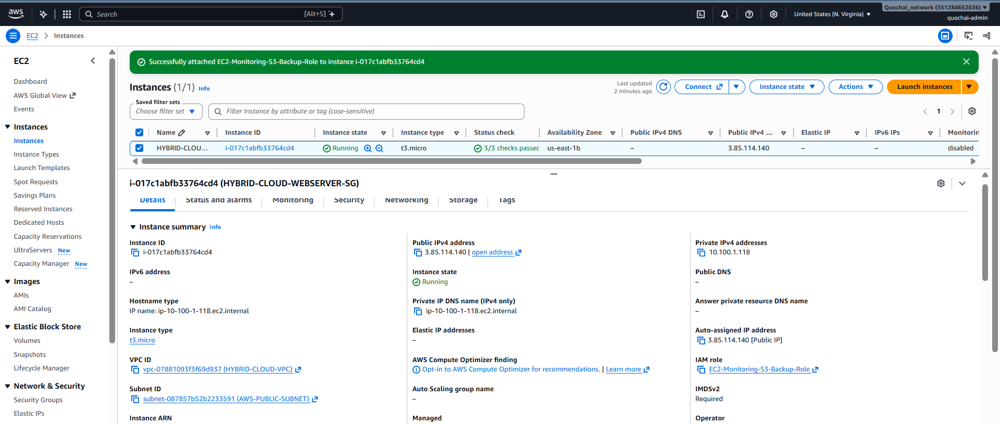

### 13. Install AWS CLI on EC2
Connect via SSH to the EC2 server and install the AWS CLI:
```bash
sudo apt update
sudo apt install -y awscli
```
Check the version:
```bash
aws --version
```

Verify AWS access rights from the IAM Role:
```bash
aws sts get-caller-identity
```
**Image 4.7.17: Install AWS CLI on EC2**
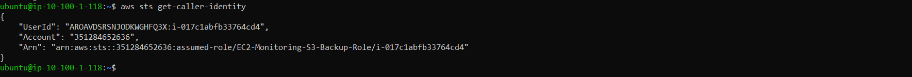

If the command returns the ARN information of the IAM Role attached to EC2, authentication is working correctly.

### 14. Create a Backup File of Monitoring Configurations
Create a temporary storage directory for the backup:

```bash
mkdir -p ~/monitoring-backup
```
Archive the Prometheus, Node Exporter, and Grafana configuration files:
```bash
  sudo tar -czvf ~/monitoring-backup/monitoring-config-backup.tar.gz \
  -C / \
  etc/prometheus \
  etc/default/prometheus \
  usr/lib/systemd/system/prometheus.service \
  etc/systemd/system/node_exporter.service \
  etc/grafana \
  etc/default/grafana-server \
  usr/lib/systemd/system/grafana-server.service
```
Set permissions so the ubuntu user can access the backup file:
```bash
sudo chown ubuntu:ubuntu ~/monitoring-backup/monitoring-config-backup.tar.gz
```
Verify the backup file:
```bash
ls -lh ~/monitoring-backup/
```
Image 4.7.18: Successful Backup File Creation

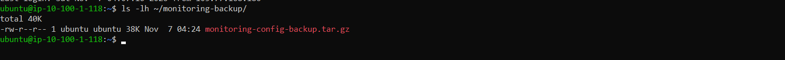

### 15. Upload Backup File to Amazon S3

```bash
aws s3 cp ~/monitoring-backup/monitoring-config-backup.tar.gz \
  s3://hybrid-cloud-monitoring-backup-qhai/monitoring-backup/monitoring-config-backup.tar.gz \
  --sse AES256
```
The parameter --sse AES256 instructs S3 to encrypt the data on the server side using SSE-S3.

Verify that the file has been uploaded to the bucket:

```bash
aws s3 ls s3://hybrid-cloud-monitoring-backup-qhai/monitoring-logs/

```
Image 4.7.19: Successful Upload to Amazon S3

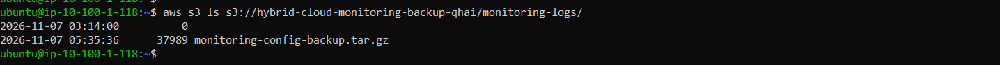

### 16. Test Backup File Recovery Capability
Try downloading the backup file from S3 to a different directory on EC2.
Create a directory to download the backup file:
```bash
mkdir -p ~/monitoring-restore-test
```

```bash
aws s3 cp \
  s3://hybrid-cloud-monitoring-backup-qhai/monitoring-backup/monitoring-config-backup.tar.gz \
  ~/monitoring-restore-test/monitoring-config-backup.tar.gz
```
Check the downloaded file:
```bash
ls -lh ~/monitoring-restore-test/
```
Check the list of contents inside the archive file:

```bash
tar -tzf ~/monitoring-restore-test/monitoring-config-backup.tar.gz
```

If the command displays the backed-up directories and configuration files, it confirms that uploading and downloading data from Amazon S3 works successfully.

Image 4.7.20: Monitoring System Configuration Backup on Amazon S3

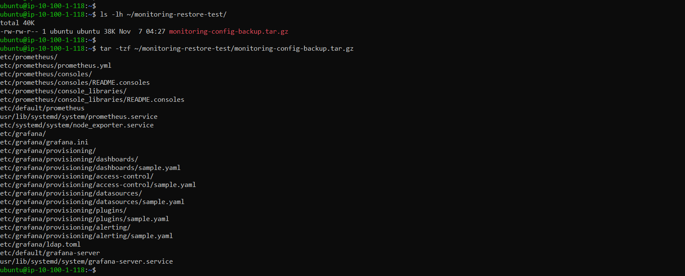

### Conclusion

In this section, we deployed a centralized monitoring system using Prometheus, Node Exporter, and Grafana on an AWS EC2 server, while leveraging Amazon S3 to store configuration backups.

Node Exporter collects Linux server metrics, Prometheus stores and processes monitoring data, and Grafana visualizes the data through dashboards.

The monitoring solution helps administrators track server resource utilization, detect abnormal performance, and evaluate cloud infrastructure health. Amazon S3 adds configuration backup storage capabilities, supporting system recovery when needed.

In the next section, we will proceed to test the entire Hybrid Cloud system and clean up AWS resources.
