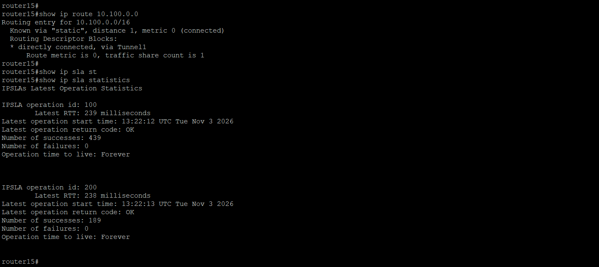
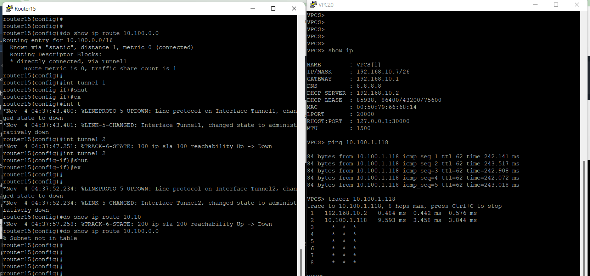
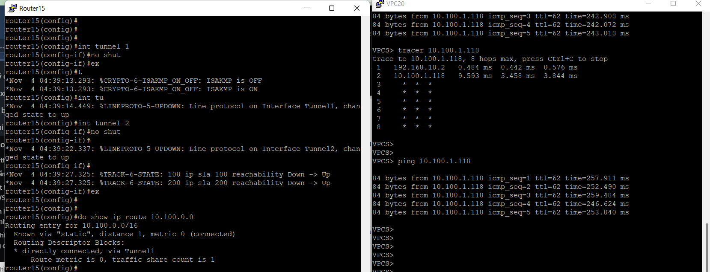

---
title: "Routing Configuration and VPN Failover Mechanisms"
date: 2026-10-31
weight: 6
chapter: false
pre: " <b> 5.6. </b> "
---

#### Overview

In this section, we will configure routing and VPN failover mechanisms to improve the availability of the Hybrid Cloud network.

The network uses two on-premises routers connected to AWS through separate Site-to-Site VPN connections. Router15 acts as the primary router, while Router16 provides a backup connection.

The primary VPN path is preferred during normal operation. If the primary path becomes unavailable, traffic is expected to use the backup VPN path. This design helps maintain communication between the enterprise network and AWS when a VPN tunnel or primary router fails.

#### 1. Review the Network Topology

Before configuring routing, review the Hybrid Cloud topology and identify the primary and backup paths.

The design includes:

- **Router15, Router17:** Primary on-premises VPN router.
- **Router16, Router18:** Backup on-premises VPN router.
- **AWS Virtual Private Gateway:** Terminates the AWS Site-to-Site VPN connections.
- **Primary VPN connection:** Connects Router15 and Router17 to AWS.
- **Backup VPN connection:** Connects Router16 and Router18 to AWS.
- **Enterprise internal networks:** Headquarters and branch office networks.
- **AWS VPC:** Cloud network using CIDR `10.100.0.0/16`.

Each Customer Gateway must represent the correct public endpoint of its corresponding on-premises VPN device.


#### 2. Configure the Primary VPN Route

Configure Router15 and Router17 as the preferred path to the AWS VPC.

The routing design should ensure that traffic destined for `10.100.0.0/16` uses the primary VPN tunnel under normal conditions.

For a Cisco router using static routing, a route can be configured with a tracking object:
Example:
```bash
ip route 10.100.0.0 255.255.0.0 Tunnel1 track 100 1
```

The tracking object must monitor a destination that is reachable through the primary VPN path. Configure the tracking mechanism according to the actual tunnel interface and network topology.


#### 3. Configure the Backup VPN Route

Router16 and Router18 provides an alternative path to AWS when the primary connection fails.

Configure a backup route with a higher administrative distance so that it is not selected while the primary route is available.

Example:

```bash
ip route 10.100.0.0 255.255.0.0 Tunnel2 track 200 10
```


If both routers participate in a shared internal routing domain, ensure that route advertisement and route preference are configured consistently. The backup path must be reachable when the primary route is withdrawn.


#### 4. Configure Route Tracking and Failover

Route tracking allows the router to detect whether the primary path is still usable.

For Cisco IOS, IP SLA and object tracking can be used to monitor reachability through the primary path.

Example configuration:

```bash
ip sla 100
   icmp-echo 169.254.161.73 source-interface Tunnel1
   timeout 1000
   frequency 5
exit
ip sla schedule 100  life forever start-time now
track 100 ip sla 100 reachability
```
```bash
ip sla 200
   icmp-echo 169.254.39.93 source-interface Tunnel2
   timeout 1000
   frequency 5
exit
ip sla schedule 200  life forever start-time now
track 200 ip sla 200 reachability
```

The destination and source interface must be selected according to the actual network design. The monitoring destination should be reachable through the primary path and should not be reachable through an unrelated route that could hide a primary VPN failure.

Associate the tracking object with the primary static route. When the tracked path becomes unavailable, the primary route is removed from the routing table, allowing the backup route to be selected.


#### 5. Verify the Routing Table

After configuring the primary and backup routes, verify which path is currently selected.

On the Cisco router, use:

```bash
show ip route 10.100.0.0
show ip sla statistics
```

During normal operation, confirm that the route to `10.100.0.0/16` uses the primary VPN path.

Also verify that the backup route is available and can be installed when the primary route is withdrawn.

**Image 5.6.1: Verify the Primary Route**



#### 6. Test VPN Failover

Perform a controlled failover test to verify that the backup path works correctly.

1. Confirm that the primary VPN connection is operational.
2. Verify connectivity from an on-premises host to an AWS resource.
3. Record the current routing table.
4. Temporarily disable the primary VPN path in the lab.
5. Wait for the tracking mechanism to detect the failure.
6. Verify that the primary route is withdrawn.
7. Confirm that traffic uses the backup VPN path.
8. Test connectivity to the AWS resource again.
9. Restore the primary VPN path and verify that normal route preference is recovered.

Use the following commands to check routing and connectivity:

```bash
show ip route 10.100.0.0
show track 100
show crypto ipsec sa
ping <AWS_PRIVATE_IP>
```

The test should demonstrate that traffic can use the backup path when the primary path is unavailable.

**Image 5.6.2: Primary VPN Failure Test**




#### 7. Restore the Primary Path and Verify Recovery

After completing the failover test:

1. Re-enable the primary VPN path.
2. Wait for the VPN tunnel and tracking object to recover.
3. Check the routing table again.
4. Confirm that the primary route is preferred.
5. Test connectivity between the on-premises network and AWS.

This step verifies that the routing design can recover after a temporary failure.

**Image 5.6.3: Primary VPN Path Recovery**



#### Conclusion

In this section, we configured primary and backup VPN routing, implemented route tracking, and tested failover and recovery between the on-premises enterprise network and AWS.

Router15 provides the preferred VPN path, while Router16 acts as the backup path. The failover mechanism improves network availability by allowing traffic to use the alternative connection when the primary path becomes unavailable.

In the next section, we will deploy a centralized monitoring solution using Prometheus, Node Exporter, and Grafana.
