---
title: "Triển khai hệ thống giám sát tập trung Prometheus và Grafana và dịch vụ sao lưu Amazon S3"
date: 2026-11-01
weight: 7
chapter: false
pre: " <b> 5.7. </b> "
---

#### Tổng quan

Trong phần này, chúng ta sẽ triển khai giải pháp giám sát tập trung nhằm theo dõi hiệu suất và mức độ sử dụng tài nguyên của máy chủ Cloud đồng thời sao lưu cấu hình hệ thống giám sát lên Amazon S3 trong hệ thống Hybrid Cloud.

Hệ thống giám sát được triển khai trên máy chủ EC2 sử dụng Ubuntu 24.04 và bao gồm ba thành phần chính:

- **Prometheus:** Thu thập và lưu trữ dữ liệu giám sát dạng chuỗi thời gian.
- **Node Exporter:** Thu thập thông tin tài nguyên máy chủ Linux, bao gồm CPU, RAM, ổ đĩa và mạng.
- **Grafana:** Trực quan hóa dữ liệu giám sát thông qua Dashboard và biểu đồ.

Các thành phần phối hợp với nhau giúp quản trị viên theo dõi hiệu suất máy chủ, phân tích xu hướng sử dụng tài nguyên và phát hiện các vấn đề tiềm ẩn của hạ tầng.

Dich vụ sao lưu Amazon S3 được sử dụng để lưu trữ các bản sao lưu cấu hình của hệ thống giám sát. Khi máy chủ EC2 gặp sự cố hoặc cần triển khai lại, quản trị viên có thể tải các bản sao lưu từ S3 để khôi phục cấu hình.
Trong mô hình này sử dụng:

- **Amazon EC2:** Tạo và gửi file sao lưu lên S3.
- **Amazon S3:** Lưu trữ file sao lưu cấu hình Prometheus, Node Exporter và Grafana.
- **IAM Role:** Cấp quyền truy cập S3 cho EC2 mà không cần lưu Access Key và Secret Key trên máy chủ.

#### 1. Chuẩn bị môi trường giám sát

Trước khi cài đặt các thành phần giám sát, tiến hành kết nối SSH đến máy chủ EC2.

Sử dụng câu lệnh sau trên máy tính cá nhân:

```bash
ssh -i "hybrid-cloud-webserver-key.pem" ubuntu@44.203.161.19
```

 `44.203.161.19` là địa chỉ IPv4 Public hiện tại của máy chủ EC2.

Cập nhật danh sách gói phần mềm Ubuntu:

```bash
sudo apt update
sudo apt upgrade -y
```

Kiểm tra phiên bản hệ điều hành:

```bash
lsb_release -a
```

Xác nhận máy chủ đang sử dụng Ubuntu 24.04.

**Hình 5.7.1: Kết nối SSH đến máy chủ EC2**

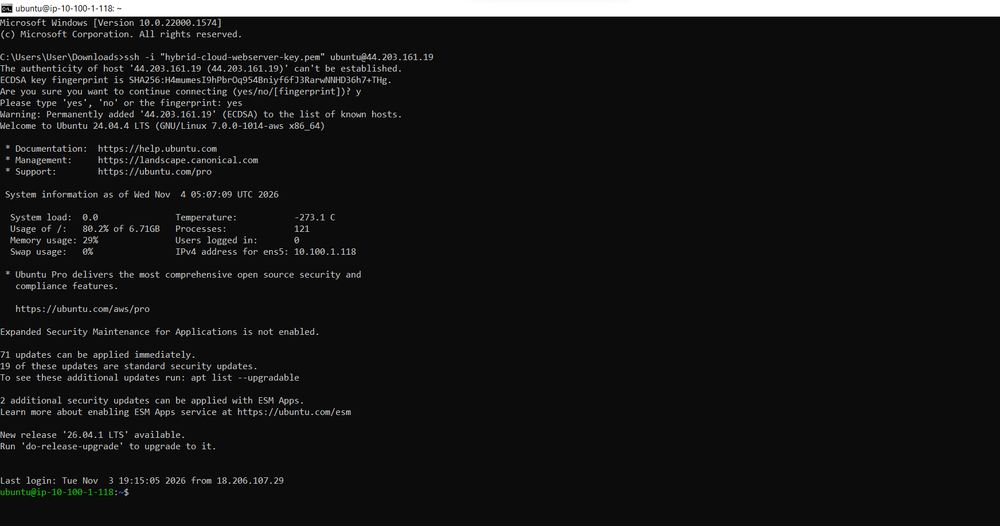
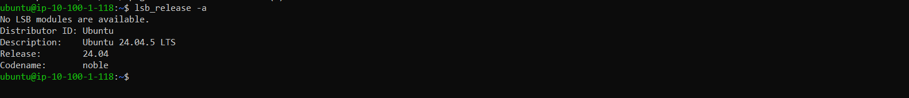

#### 2. Cài đặt Node Exporter

Node Exporter có nhiệm vụ thu thập các thông số phần cứng và hệ điều hành Linux, sau đó cung cấp dữ liệu để Prometheus truy vấn.

Tạo tài khoản hệ thống riêng:

```bash
sudo useradd --no-create-home --shell /usr/sbin/nologin node_exporter
```

Tải và giải nén Node Exporter:

```bash
cd /tmp

wget https://github.com/prometheus/node_exporter/releases/download/v1.7.0/node_exporter-1.7.0.linux-amd64.tar.gz

tar xvf node_exporter-1.7.0.linux-amd64.tar.gz
```

Sao chép chương trình thực thi vào thư mục hệ thống:

```bash
sudo cp node_exporter-1.7.0.linux-amd64/node_exporter /usr/local/bin/

sudo chown node_exporter:node_exporter /usr/local/bin/node_exporter
```

Tạo file cấu hình dịch vụ systemd:

```bash
sudo nano /etc/systemd/system/node_exporter.service
```

Thêm nội dung sau:

```ini
[Unit]
Description=Node Exporter
After=network.target

[Service]
User=node_exporter
Group=node_exporter
Type=simple
ExecStart=/usr/local/bin/node_exporter

[Install]
WantedBy=multi-user.target
```

Lưu file và khởi động dịch vụ:

```bash
sudo systemctl daemon-reload
sudo systemctl enable --now node_exporter
```

Kiểm tra trạng thái dịch vụ:

```bash
sudo systemctl status node_exporter
```

Node Exporter mặc định sử dụng cổng TCP `9100`.

**Hình 5.7.2: Cài đặt Node Exporter và kiểm tra trạng thái dịch vụ**

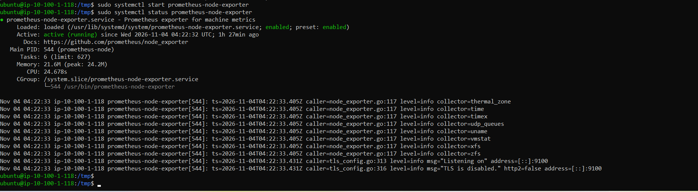

#### 3. Cài đặt Prometheus

Prometheus chịu trách nhiệm thu thập và lưu trữ dữ liệu giám sát từ Node Exporter.

Tạo tài khoản hệ thống và các thư mục cần thiết:

```bash
sudo useradd --no-create-home --shell /usr/sbin/nologin prometheus

sudo mkdir -p /etc/prometheus

sudo mkdir -p /var/lib/prometheus
```

Tải và giải nén Prometheus:

```bash
cd /tmp

wget https://github.com/prometheus/prometheus/releases/download/v2.54.1/prometheus-2.54.1.linux-amd64.tar.gz

tar xvf prometheus-2.54.1.linux-amd64.tar.gz
```

Sao chép các file cần thiết:

```bash
sudo cp prometheus-2.54.1.linux-amd64/prometheus /usr/local/bin/

sudo cp prometheus-2.54.1.linux-amd64/promtool /usr/local/bin/

sudo cp -r prometheus-2.54.1.linux-amd64/consoles /etc/prometheus/

sudo cp -r prometheus-2.54.1.linux-amd64/console_libraries /etc/prometheus/
```

Thiết lập quyền sở hữu:

```bash
sudo chown prometheus:prometheus /usr/local/bin/prometheus

sudo chown prometheus:prometheus /usr/local/bin/promtool

sudo chown -R prometheus:prometheus /etc/prometheus

sudo chown -R prometheus:prometheus /var/lib/prometheus
```

#### 4. Cấu hình Prometheus

Tạo file cấu hình Prometheus:

```bash
sudo nano /etc/prometheus/prometheus.yml
```

Thêm nội dung sau:

```yaml
global:
  scrape_interval: 15s

scrape_configs:
  - job_name: "prometheus"
    static_configs:
      - targets: ["localhost:9090"]

  - job_name: "node_exporter"
    static_configs:
      - targets: ["localhost:9100"]
```

Cấu hình trên khai báo hai đối tượng giám sát:

- `localhost:9090`: Prometheus tự giám sát các thông số hoạt động của chính nó.
- `localhost:9100`: Prometheus thu thập thông tin tài nguyên máy chủ Linux từ Node Exporter.

Thiết lập quyền sở hữu file cấu hình:

```bash
sudo chown prometheus:prometheus /etc/prometheus/prometheus.yml
```

Tạo file dịch vụ systemd:

```bash
sudo nano /etc/systemd/system/prometheus.service
```

Thêm nội dung:

```ini
[Unit]
Description=Prometheus Monitoring
Wants=network-online.target
After=network-online.target

[Service]
User=prometheus
Group=prometheus
Type=simple
ExecStart=/usr/local/bin/prometheus \
  --config.file=/etc/prometheus/prometheus.yml \
  --storage.tsdb.path=/var/lib/prometheus/ \
  --web.listen-address=0.0.0.0:9090

[Install]
WantedBy=multi-user.target
```

Khởi động và kích hoạt Prometheus:

```bash
sudo systemctl daemon-reload

sudo systemctl enable --now prometheus
```

Kiểm tra trạng thái dịch vụ:

```bash
sudo systemctl status prometheus
```

**Hình 5.7.3: Kiểm tra trạng thái dịch vụ Prometheus**

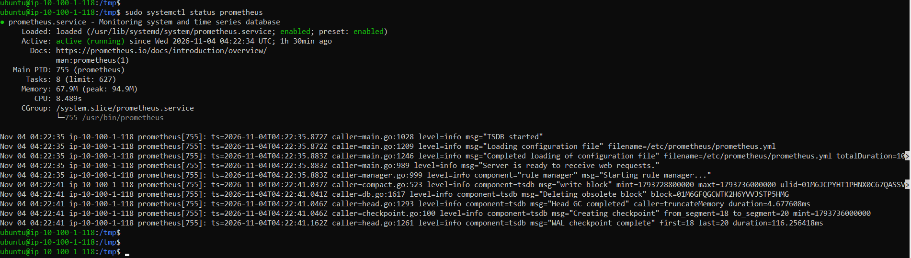

#### 5. Kiểm tra các Prometheus Targets

Mở trình duyệt và truy cập địa chỉ:

```text
http://44.203.161.19:9090/classic/targets
```

`44.203.161.19` là địa chỉ IPv4 Public hiện tại của máy chủ EC2.

Trang Targets hiển thị các endpoint giám sát đã được cấu hình.

Kiểm tra cả hai đối tượng có trạng thái **UP**:

- `prometheus`
- `node_exporter`

Nếu một target có trạng thái DOWN, cần kiểm tra dịch vụ tương ứng và file cấu hình Prometheus.

**Hình 5.7.4: Kiểm tra trạng thái Prometheus Targets**

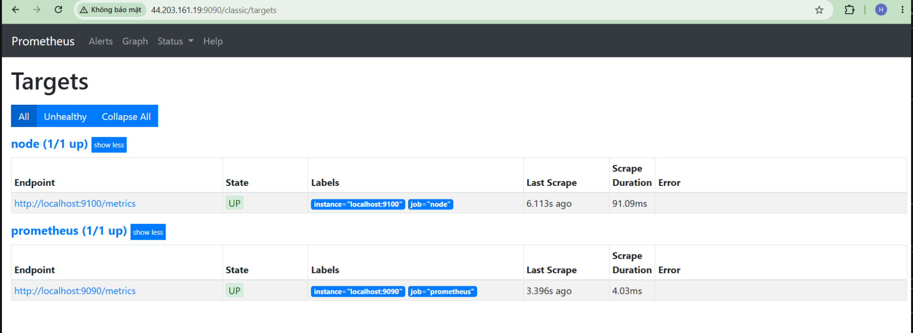

#### 6. Cài đặt Grafana

Grafana cung cấp giao diện Dashboard để trực quan hóa dữ liệu giám sát được Prometheus thu thập.

Cài đặt các gói phần mềm cần thiết:

```bash
sudo apt-get install -y apt-transport-https software-properties-common wget
```

Tạo thư mục lưu trữ khóa:

```bash
sudo mkdir -p /etc/apt/keyrings
```

Thêm khóa xác thực repository của Grafana:

```bash
wget -q -O - https://apt.grafana.com/gpg.key | gpg --dearmor | sudo tee /etc/apt/keyrings/grafana.gpg > /dev/null
```

Thêm Grafana repository:

```bash
echo "deb [signed-by=/etc/apt/keyrings/grafana.gpg] https://apt.grafana.com stable main" | sudo tee /etc/apt/sources.list.d/grafana.list
```

Cập nhật danh sách gói và cài đặt Grafana:

```bash
sudo apt-get update

sudo apt-get install -y grafana
```

Kích hoạt và khởi động Grafana:

```bash
sudo systemctl enable --now grafana-server
```

Kiểm tra trạng thái dịch vụ:

```bash
sudo systemctl status grafana-server
```

Grafana mặc định sử dụng cổng TCP `3000`.

**Hình 5.7.5: Cài đặt Grafana và kiểm tra trạng thái dịch vụ**

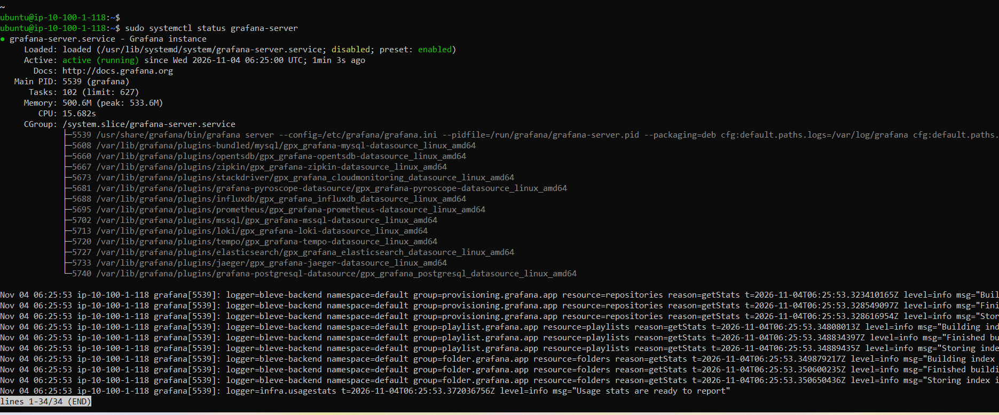

#### 7. Truy cập Grafana và thêm Prometheus Data Source

Mở trình duyệt và truy cập Grafana:

```text
http://44.203.161.19:3000
```

Đăng nhập bằng tài khoản quản trị đã cấu hình. Với cài đặt mới, thông tin đăng nhập mặc định là:

- Username: `admin`
- Password: `admin`

Grafana thường yêu cầu thay đổi mật khẩu mặc định sau lần đăng nhập đầu tiên.

Tiến hành thêm Prometheus làm nguồn dữ liệu:

1. Mở **Connections**.
2. Chọn **Data sources**.
3. Nhấn **Add data source**.
4. Chọn **Prometheus**.
5. Nhập địa chỉ máy chủ Prometheus:

```text
http://localhost:9090
```

6. Nhấn **Save & test**.

Xác nhận Grafana có thể kết nối thành công đến Prometheus.

**Hình 5.7.6: Thêm Prometheus Data Source trong Grafana**

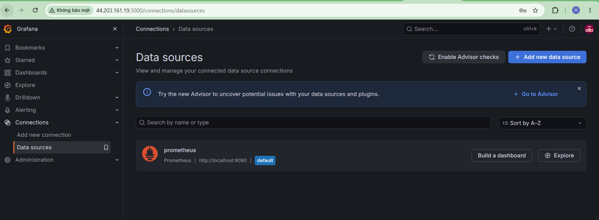

#### 8. Tạo Dashboard giám sát hệ thống

Sau khi thêm Prometheus Data Source, tiến hành tạo Dashboard để trực quan hóa hiệu suất máy chủ.

1. Mở **Dashboards**.
2. Chọn **New**.
3. Nhấn **New dashboard**.
4. Thêm một visualization.
5. Chọn Prometheus làm nguồn dữ liệu.
6. Nhập truy vấn PromQL.
7. Lưu Dashboard.

Một số truy vấn PromQL tham khảo:

**Giám sát CPU:**

```promql
100 * (1 - avg by (instance) (rate(node_cpu_seconds_total{mode="idle"}[5m])))
```

**Giám sát RAM:**

```promql
100 * (1 - node_memory_MemAvailable_bytes / node_memory_MemTotal_bytes)
```

**Giám sát dung lượng ổ đĩa:**

```promql
100 * (1 - node_filesystem_avail_bytes{mountpoint="/",fstype!="tmpfs"} / node_filesystem_size_bytes{mountpoint="/",fstype!="tmpfs"})
```

**Giám sát lưu lượng mạng nhận vào:**

```promql
rate(node_network_receive_bytes_total{device!="lo"}[5m])
```

Dashboard có thể hiển thị các thông số CPU, RAM, dung lượng ổ đĩa và lưu lượng mạng của máy chủ.

**Hình 5.7.7: Bảng điều khiển giám sát Grafana**

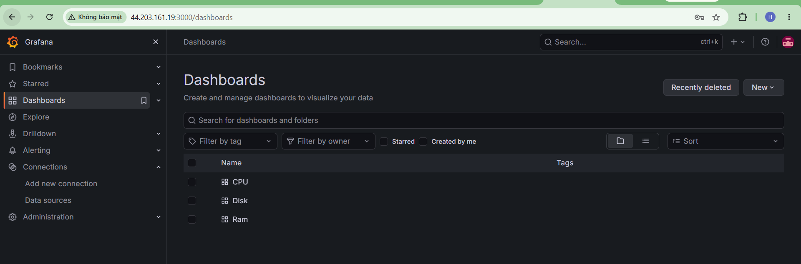

#### 9. Kiểm tra hoạt động của hệ thống giám sát

Để xác nhận hệ thống có thể thu thập dữ liệu theo thời gian thực, tiến hành tạo tải CPU, RAM, Disk tạm thời trên máy chủ EC2.

Cài đặt stress-ng nếu máy chủ chưa có:

```bash
sudo apt update

sudo apt install -y stress-ng
```

Tạo tải CPU trong khoảng thời gian ngắn:

```bash
stress-ng --cpu 2 --timeout 60s
```

Trong khi bài kiểm tra đang chạy:

1. Mở Dashboard Grafana.
2. Quan sát biểu đồ CPU Utilization.
3. Kiểm tra mức sử dụng CPU có tăng trong quá trình kiểm tra hay không.
4. Chờ quá trình tạo tải kết thúc.
5. Xác nhận mức sử dụng CPU giảm dần về trạng thái bình thường.

Tạo tải RAM trong khoảng thời gian ngắn:

```bash
stress-ng --vm 1 --vm-bytes 200M --vm-keep --timeout 60s
```

Trong khi bài kiểm tra đang chạy:

1. Quan sát biểu đồ Memory Usage trên Grafana.
2. Kiểm tra mức sử dụng RAM có tăng trong quá trình kiểm tra hay không.
3. Chờ quá trình tạo tải kết thúc.
4. Xác nhận mức sử dụng RAM giảm dần về trạng thái bình thường.

Kiểm tra dung lượng Disk và tạo hoạt động đọc/ghi Disk:

```bash
df -h
stress-ng --hdd 1 --hdd-bytes 100M --timeout 60s
```

Trong khi bài kiểm tra đang chạy:

1. Quan sát biểu đồ Disk I/O trên Grafana.
2. Kiểm tra hoạt động đọc/ghi Disk có tăng trong quá trình kiểm tra hay không.
3. Chờ quá trình tạo tải kết thúc.
4. Xác nhận hoạt động Disk trở về trạng thái bình thường.

Sau khi kiểm tra, xác nhận Prometheus vẫn hiển thị cả hai monitoring target ở trạng thái UP.

**Hình 5.7.8: Tạo tải CPU để kiểm tra giám sát**

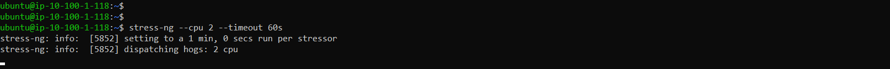

**Hình 5.7.9: Theo dõi CPU trên Grafana**


**Hình 5.7.10: Tạo tải RAM để kiểm tra giám sát**

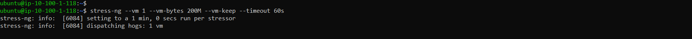

**Hình 5.7.11: Theo dõi RAM trên Grafana**


**Hình 5.7.12: Tạo tải Disk để kiểm tra giám sát**

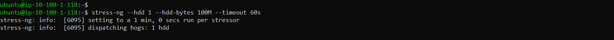

**Hình 5.7.13: Theo dõi Disk trên Grafana**


### 10 tạo aws S3
Truy cập AWS Management Console và thực hiện:

1. Tìm kiếm dịch vụ **S3**.
2. Chọn **Create bucket**.
3. Nhập tên Bucket duy nhất trên toàn AWS
4. Chọn AWS Region: **US East (N. Virginia) – us-east-1**, cùng Region với EC2.
5. Giữ tùy chọn **Block all public access** được bật.
6. Giữ các thiết lập mặc định còn lại và nhấn **Create bucket**.

Bucket được sử dụng riêng để lưu trữ các bản sao lưu, không cần cấp quyền truy cập công khai.

**Hình 5.7.14: Tạo bucket**

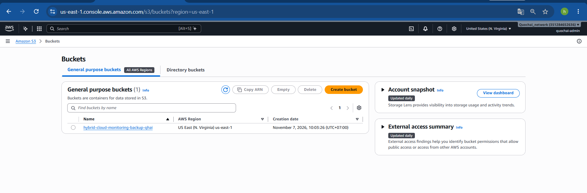

### 11. Tạo IAM Policy cho phép EC2 ghi dữ liệu lên S3

Để EC2 có thể tải file sao lưu lên Bucket, cần tạo IAM Policy với quyền truy cập giới hạn.

Truy cập **IAM → Policies → Create policy → JSON** và thêm vào nội dung.

```json
{
  "Version": "2012-10-17",
  "Statement": [
    {
      "Effect": "Allow",
      "Action": [
        "s3:PutObject",
        "s3:ListBucket"
      ],
      "Resource": [
        "arn:aws:s3:::hybrid-cloud-monitoring-backup-qhai",
        "arn:aws:s3:::hybrid-cloud-monitoring-backup-qhai/*"
      ]
    }
  ]
}
```

Đặt tên Policy, ví dụ: `EC2-Monitoring-S3-Backup-Policy`, sau đó tạo Policy.

**Hình 5.7.15: Tạo IAM-Policy**

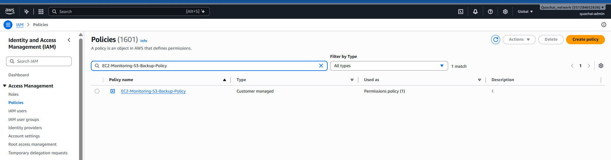

### 12. Gắn IAM Role vào máy chủ EC2

1. Truy cập **IAM → Roles → Create role**.
2. Chọn **AWS service**.
3. Chọn **EC2** làm Use case.
4. Gắn Policy `EC2-Monitoring-S3-Backup-Policy` vừa tạo.
5. Đặt tên Role, ví dụ: `EC2-Monitoring-S3-Backup-Role`.
6. Hoàn tất quá trình tạo Role.
7. Truy cập **EC2 → Instances** và chọn máy chủ đang chạy Prometheus, Grafana.
8. Chọn **Actions → Security → Modify IAM role**.
9. Chọn Role `EC2-Monitoring-S3-Backup-Role` và cập nhật.

IAM Role cho phép EC2 nhận thông tin xác thực tạm thời để truy cập S3. Không cần tạo hoặc lưu Access Key và Secret Key trên máy chủ.

**Hình 5.7.16: Tạo IAM-role**

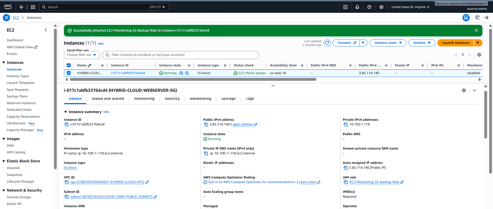

### 13. Cài đặt AWS CLI trên EC2
Kết nối SSH đến máy chủ EC2 và cài đặt AWS CLI:
```bash
sudo apt update
sudo apt install -y awscli
```

Kiểm tra phiên bản:
```bash
aws --version
```

Kiểm tra quyền truy cập AWS từ IAM Role:
```bash
aws sts get-caller-identity
```
**Hình 5.7.17: Cài đặt AWS CLI trên EC2**

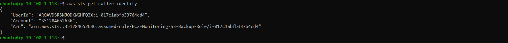

Nếu lệnh trả về thông tin ARN của IAM Role đã gắn vào EC2, quá trình xác thực đã hoạt động.

### 14. Tạo file sao lưu cấu hình giám sát

Tạo thư mục lưu trữ tạm thời cho bản sao lưu:

```bash
mkdir -p ~/monitoring-backup
```

Đóng gói các file cấu hình Prometheus, Node Exporter và Grafana:

```bash
  sudo tar -czvf ~/monitoring-backup/monitoring-config-backup.tar.gz \
  -C / \
  etc/prometheus \
  etc/default/prometheus \
  usr/lib/systemd/system/prometheus.service \
  etc/systemd/system/node_exporter.service \
  etc/grafana \
  etc/default/grafana-server \
  usr/lib/systemd/system/grafana-server.service
```

Phân quyền để tài khoản Ubuntu có thể tải file sao lưu:

```bash
sudo chown ubuntu:ubuntu ~/monitoring-backup/monitoring-config-backup.tar.gz
```

Kiểm tra file sao lưu:

```bash
ls -lh ~/monitoring-backup/
```

**Hình 5.7.18: Tạo file sao lưu thành công**

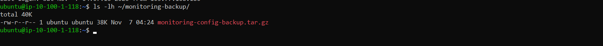

### 15. Tải file sao lưu lên Amazon S3**


```bash
aws s3 cp ~/monitoring-backup/monitoring-config-backup.tar.gz \
  s3://hybrid-cloud-monitoring-backup-qhai/monitoring-backup/monitoring-config-backup.tar.gz \
  --sse AES256
```

Tham số `--sse AES256` yêu cầu S3 mã hóa dữ liệu phía máy chủ bằng SSE-S3.

Kiểm tra file đã được tải lên Bucket:

```bash
aws s3 ls s3://hybrid-cloud-monitoring-backup-qhai/monitoring-logs/

```
**Hình 5.7.19: tải file lên aws S3 thành công.**

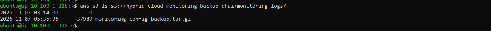

### 16. Kiểm tra khả năng khôi phục file sao lưu

Thử tải file sao lưu từ S3 về một thư mục khác trên EC2.
Tạo thư mục để tải file sao lưu:
```bash
mkdir -p ~/monitoring-restore-test
```

```bash
aws s3 cp \
  s3://hybrid-cloud-monitoring-backup-qhai/monitoring-backup/monitoring-config-backup.tar.gz \
  ~/monitoring-restore-test/monitoring-config-backup.tar.gz
```

Kiểm tra file đã tải về:

```bash
ls -lh ~/monitoring-restore-test/
```

Kiểm tra danh sách nội dung bên trong file nén:

```bash
tar -tzf ~/monitoring-restore-test/monitoring-config-backup.tar.gz
```

Nếu lệnh hiển thị các thư mục và file cấu hình đã sao lưu, có thể xác nhận quá trình tải lên và tải xuống dữ liệu từ Amazon S3 hoạt động thành công.

**Hình 5.7.20: File sao lưu cấu hình hệ thống giám sát trên Amazon S3**

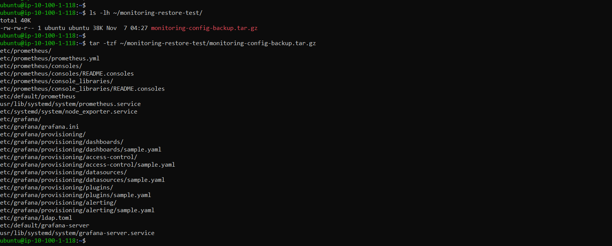


#### Kết luận

Trong phần này, chúng ta đã triển khai hệ thống giám sát tập trung sử dụng Prometheus, Node Exporter và Grafana trên máy chủ AWS EC2, đồng thời sử dụng Amazon S3 để lưu trữ các bản sao lưu cấu hình.

Node Exporter thu thập các thông số của máy chủ Linux, Prometheus lưu trữ và xử lý dữ liệu giám sát, còn Grafana trực quan hóa dữ liệu thông qua các Dashboard.

Giải pháp giám sát giúp quản trị viên theo dõi mức độ sử dụng tài nguyên máy chủ, phát hiện hiệu suất bất thường và đánh giá trạng thái hoạt động của hạ tầng Cloud. Amazon S3 bổ sung khả năng lưu trữ bản sao lưu cấu hình, hỗ trợ quá trình khôi phục hệ thống khi cần thiết.

Trong phần tiếp theo, chúng ta sẽ tiến hành kiểm tra toàn bộ hệ thống Hybrid Cloud và dọn dẹp các tài nguyên AWS.
