---
title: "Hybrid Cloud System Testing and AWS Resource Cleanup"
date: 2026-10-30
weight: 8
chapter: false
pre: " <b> 5.8. </b> "
---

#### Overview

In this final section, we will verify the operation of the Hybrid Cloud system connecting the multi-branch enterprise network simulated in EVE-NG with the AWS cloud environment.

The testing process covers network connectivity, Site-to-Site VPN tunnels, routing and failover mechanisms, EC2 server availability, and the centralized monitoring solution using Prometheus, Node Exporter, and Grafana.

After completing the tests, we will review the AWS resources and clean up resources that are no longer required to reduce unnecessary costs.

#### 1. Review the Hybrid Cloud Architecture

Before testing, review the overall system architecture and confirm that all required components have been deployed.

The system consists of:

- **On-premises infrastructure:** Enterprise network simulated using EVE-NG, including headquarters and branch office networks.
- **AWS VPC:** Cloud network using CIDR `10.100.0.0/16`.
- **Virtual Private Gateway:** Provides the AWS endpoint for Site-to-Site VPN connections.
- **Customer Gateways:** Represent the on-premises VPN devices.
- **VPN connections:** Provide encrypted connectivity between the enterprise network and AWS.
- **EC2 instance:** Hosts the web server and monitoring components.
- **Monitoring system:** Uses Prometheus, Node Exporter, and Grafana to monitor server performance.


#### 2. Test Network Connectivity

Verify communication between the on-premises enterprise network and the AWS VPC.

From an authorized on-premises host or router, test connectivity to the private IP address of the EC2 instance.

Example:

```bash
ping 10.100.1.118
```

`10.100.1.118` is the current private IPv4 address of the EC2 instance.

Also verify that the routing table contains the expected routes to the AWS VPC:

```bash
show ip route 10.100.0.0
```

Check that the traffic is forwarded through the intended VPN path.

If connectivity fails, review the following:

- AWS route table entries.
- On-premises routing configuration.
- VPN tunnel status.
- Security Group inbound rules.
- Network ACL rules, if customized.
- Host firewall configuration.

**Image 5.8.1: Test Connectivity from the Enterprise Network to AWS**

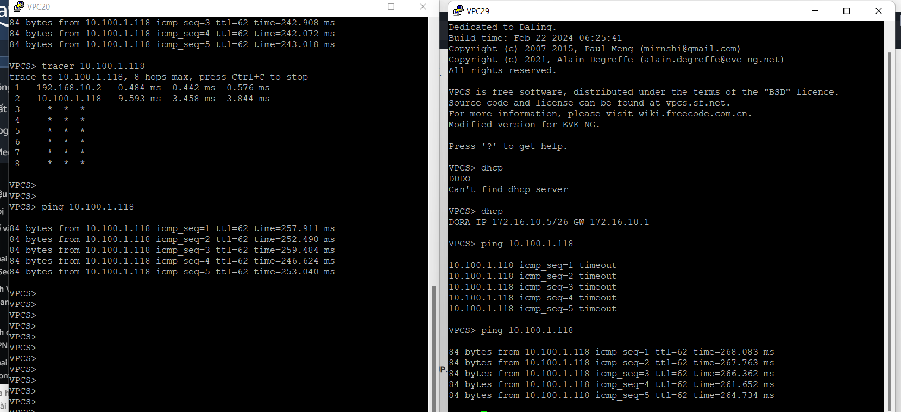

#### 3. Verify Site-to-Site VPN Connections

Open the AWS VPC console and navigate to **Site-to-Site VPN Connections**.

Select each VPN connection and inspect the **Tunnel details** tab.

Verify that the expected VPN tunnels are operational and that the status is **UP**.

On the on-premises routers, use the following Cisco IOS commands:

```bash
show crypto isakmp sa
show ip interface brief
```

Check that the IPsec security associations are established and that traffic counters increase when communication occurs between the enterprise network and AWS.

**Image 5.8.2: AWS Site-to-Site VPN Tunnel Status**

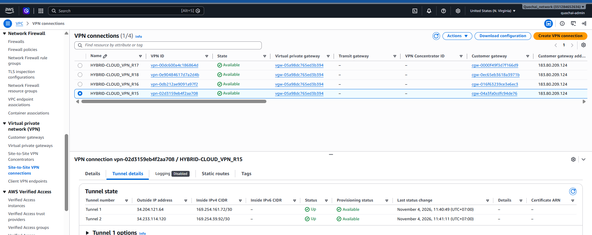
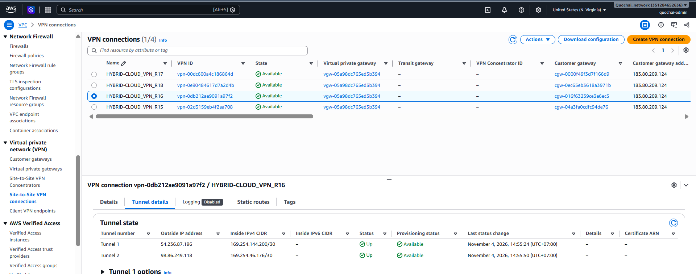
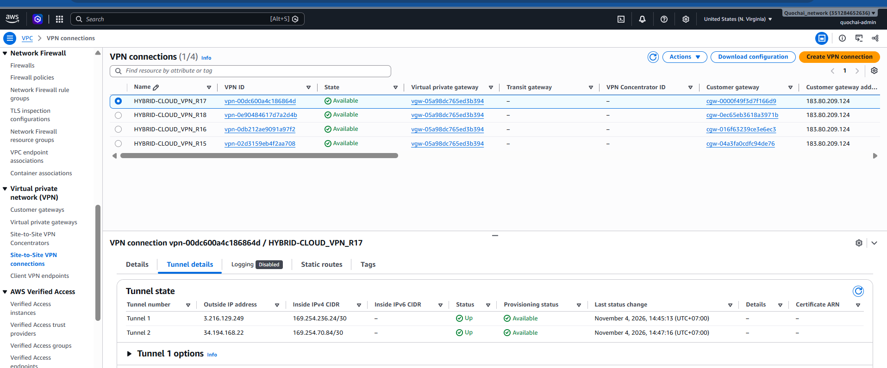
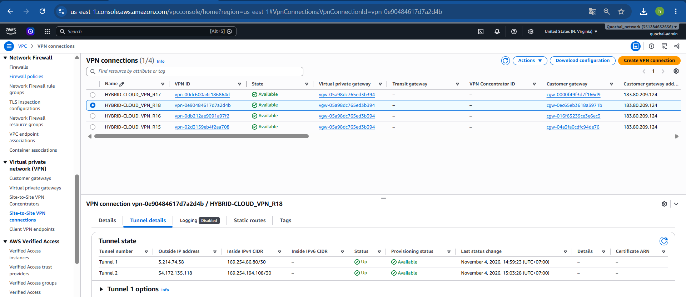
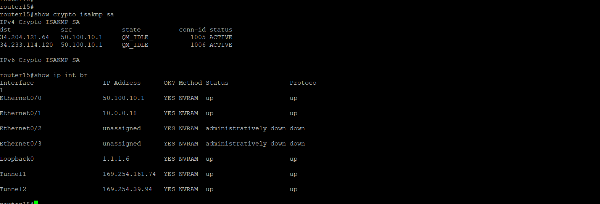
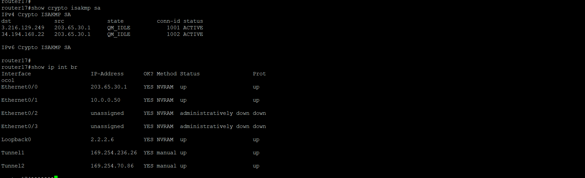
#### 4. Test Routing and VPN Failover

Verify that the primary and backup VPN paths operate according to the routing design.

The expected behavior is:

- Router15 provides the preferred primary VPN path.
- Router16 provides the backup path.
- The backup path is used when the primary path becomes unavailable.
- The primary path is preferred again after it recovers.

Check the routing and tracking status:

```bash
show ip route 10.100.0.0
show track 100
show ip sla statistics
```

Perform a controlled failover test:

1. Confirm that the primary VPN path is operational.
2. Record the current routing table.
3. Temporarily disable the primary path in the lab.
4. Verify that the tracking mechanism detects the failure.
5. Confirm that traffic uses the backup path.
6. Restore the primary path.
7. Verify that the original route preference is recovered.


**Image 5.8.3: Verify Primary and Backup VPN Routing**

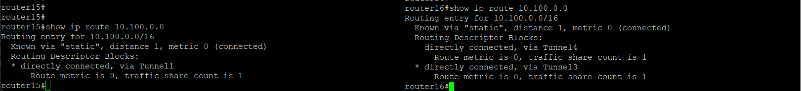

#### 5. Test the EC2 Web Server

Verify that the EC2 instance and its web server are operating correctly.

Check the Nginx service on Ubuntu:

```bash
sudo systemctl status nginx
```

If Nginx is not running, start the service:

```bash
sudo systemctl start nginx
```

Check that the web server is listening on port `80`:

```bash
sudo ss -tulpn | grep :80
```

From an authorized browser, access:

```text
http://44.203.161.19/
```

Confirm that the web page is displayed successfully.

Also verify that the EC2 instance is in the **Running** state in the AWS EC2 console.

**Image 5.8.4: Verify EC2 Instance Status**

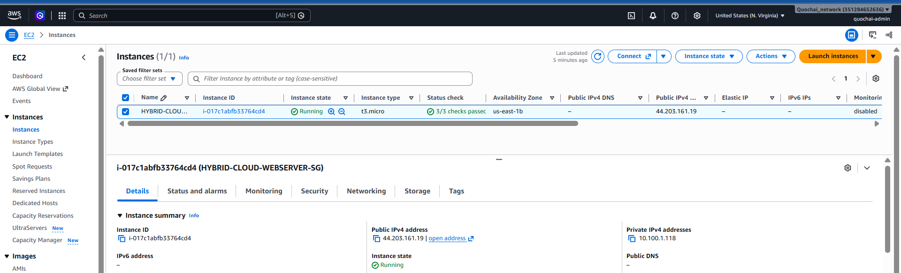

**Image 5.8.5: Access the Nginx Web Server**

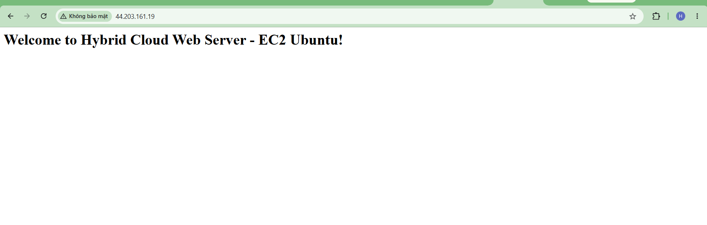

#### 6. Verify the Centralized Monitoring System

Check the status of Node Exporter, Prometheus, and Grafana on the EC2 instance.

Run:

```bash
sudo systemctl status node_exporter
sudo systemctl status prometheus
sudo systemctl status grafana-server
```

Open the Prometheus Targets page:

```text
http://<EC2_PUBLIC_IP>:9090/targets
```

Confirm that the `prometheus` and `node_exporter` targets are **UP**.

Then open Grafana:

```text
http://<EC2_PUBLIC_IP>:3000
```

Verify that the monitoring dashboard displays server metrics such as:

- CPU utilization.
- Memory utilization.
- Disk usage.
- Network traffic.

Confirm that the graphs are receiving updated data from Prometheus.

**Image 5.8.6: Prometheus Targets Verification**

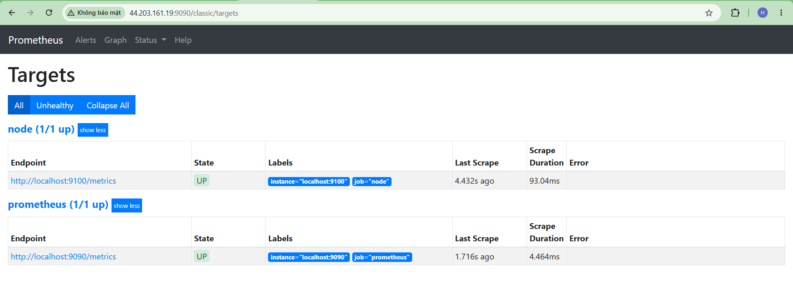

**Image 5.8.7: Centralized Monitoring Dashboard**

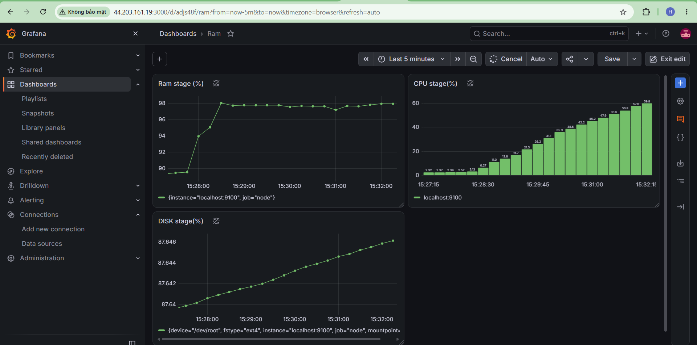

#### 7. Clean Up Unnecessary AWS Resources

**EC2 Instance**

If the instance is no longer needed:

1. Open the EC2 console.
2. Select **Instances**.
3. Select the workshop EC2 instance.
4. Choose **Instance state**.
5. Select **Terminate instance** .

**Customer Gateways**

1. Open **Customer Gateways in the VPC Console**.
2. Select the customer gateways you want to delete.
3. Select Actions.
4. Select **Delete customer gateway**.
5. Type delete and select Delete to confirm deletion.


**Site-to-Site VPN Resources**

1. Open **Site-to-Site VPN Connections**.
2. Select the VPN connections you want to delete.
3. Select Actions.
4. Select **Delete VPN connection**.
5. Type delete and select Delete to confirm deletion.


#### 8. Final System Evaluation

After completing the tests, evaluate the overall operation of the Hybrid Cloud system.

The evaluation should cover:

- Connectivity between the on-premises network and AWS.
- Establishment and operation of Site-to-Site VPN tunnels.
- Correct route selection between primary and backup paths.
- Successful failover and recovery.
- Availability of the EC2 web server.
- Successful collection of server metrics by Prometheus.
- Visualization of monitoring data in Grafana.
- Review and cleanup of unnecessary AWS resources.

The results should be recorded with screenshots and test evidence for the project report.


#### Conclusion

In this final section, we verified the operation of the Hybrid Cloud system connecting the multi-branch enterprise network simulated in EVE-NG with the AWS cloud environment.

The tests covered network connectivity, Site-to-Site VPN operation, routing and failover, EC2 web server availability, and centralized monitoring using Prometheus, Node Exporter, and Grafana.

We also reviewed AWS resource usage and identified resources that could be cleaned up to reduce unnecessary costs.

Through this workshop, we completed the design, deployment, monitoring, and evaluation of a Hybrid Cloud solution for connecting multi-branch enterprise networks to AWS.
