---
title: "Kiểm tra hệ thống Hybrid Cloud và dọn dẹp tài nguyên AWS"
date: 2026-10-30
weight: 8
chapter: false
pre: " <b> 5.8. </b> "
---

#### Tổng quan

Trong phần cuối cùng này, chúng ta sẽ kiểm tra hoạt động của hệ thống Hybrid Cloud kết nối mạng doanh nghiệp đa chi nhánh được mô phỏng trên EVE-NG với môi trường điện toán đám mây AWS.

Quá trình kiểm tra bao gồm khả năng kết nối mạng, trạng thái các VPN Tunnel Site-to-Site, cơ chế định tuyến và chuyển đổi dự phòng, khả năng hoạt động của máy chủ EC2 và hệ thống giám sát tập trung sử dụng Prometheus, Node Exporter và Grafana.

Sau khi hoàn thành các bài kiểm tra, chúng ta sẽ rà soát tài nguyên AWS và dọn dẹp những tài nguyên không còn cần thiết nhằm hạn chế các chi phí phát sinh.

#### 1. Kiểm tra tổng thể kiến trúc Hybrid Cloud

Trước khi tiến hành kiểm tra, cần rà soát kiến trúc tổng thể và xác nhận các thành phần cần thiết đã được triển khai.

Hệ thống bao gồm:

- **Hạ tầng mạng nội bộ:** Mạng doanh nghiệp được mô phỏng bằng EVE-NG, bao gồm mạng trụ sở chính và các chi nhánh.
- **AWS VPC:** Mạng Cloud sử dụng dải địa chỉ `10.100.0.0/16`.
- **Virtual Private Gateway:** Cung cấp điểm kết cuối VPN phía AWS.
- **Customer Gateways:** Đại diện cho các thiết bị VPN tại mạng nội bộ.
- **VPN Connections:** Cung cấp kết nối được mã hóa giữa mạng doanh nghiệp và AWS.
- **EC2 Instance:** Máy chủ triển khai Web Server và các thành phần giám sát.
- **Hệ thống giám sát:** Sử dụng Prometheus, Node Exporter và Grafana để theo dõi hiệu suất máy chủ.


#### 2. Kiểm tra khả năng kết nối mạng

Tiến hành kiểm tra khả năng giao tiếp giữa mạng doanh nghiệp nội bộ và AWS VPC.

Từ một máy tính hoặc router được cấp quyền trong mạng nội bộ, kiểm tra kết nối đến địa chỉ IP private của máy chủ EC2.

Ví dụ:

```bash
ping 10.100.1.118
```

`10.100.1.118` là  địa chỉ IP private thực tế của máy chủ EC2.

Kiểm tra bảng định tuyến để xác nhận route đến AWS VPC:

```bash
show ip route 10.100.0.0
```

Đảm bảo lưu lượng được chuyển tiếp thông qua đường VPN theo thiết kế.

Nếu kết nối không thành công, cần kiểm tra:

- Các route trong AWS Route Table.
- Cấu hình định tuyến tại mạng nội bộ.
- Trạng thái VPN Tunnel.
- Các quy tắc inbound của Security Group.
- Network ACL nếu đã tùy chỉnh.
- Cấu hình Firewall trên máy chủ.

**Hình 5.8.1: Kiểm tra kết nối từ mạng doanh nghiệp đến AWS**

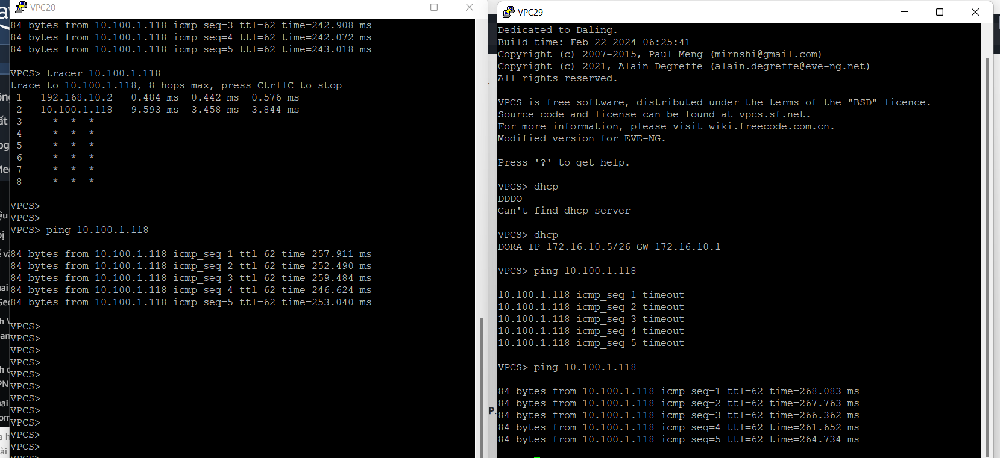

#### 3. Kiểm tra kết nối Site-to-Site VPN

Truy cập AWS VPC Console và mở mục **Site-to-Site VPN Connections**.

Chọn từng kết nối VPN và kiểm tra tab **Tunnel details**.

Xác nhận các VPN Tunnel theo thiết kế đang hoạt động và có trạng thái **UP**.

Trên các router mạng nội bộ, sử dụng các câu lệnh Cisco IOS sau:

```bash
show crypto isakmp sa
show ip interface brief
```

Kiểm tra các IPsec Security Association đã được thiết lập và bộ đếm lưu lượng tăng khi có hoạt động giao tiếp giữa mạng doanh nghiệp và AWS.

**Hình 5.8.2: Kiểm tra trạng thái VPN Tunnel trên AWS**

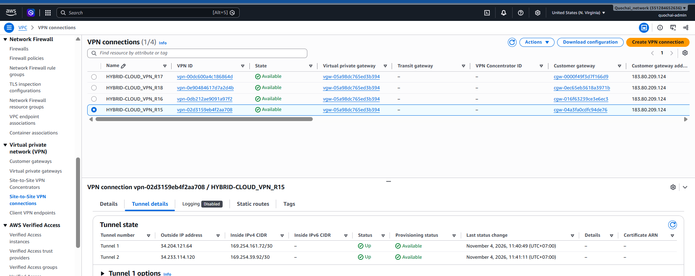
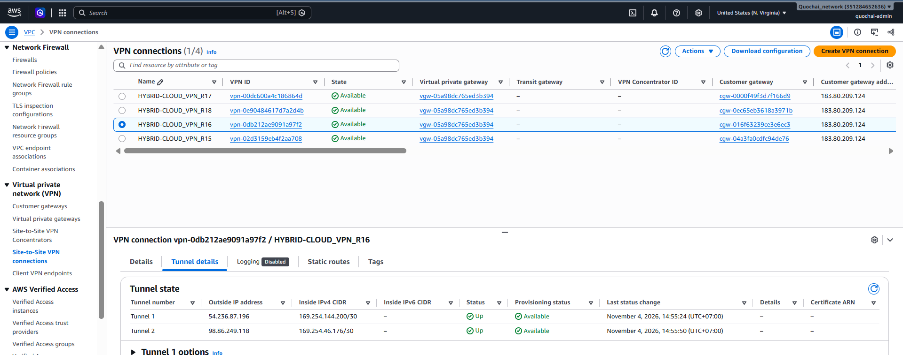
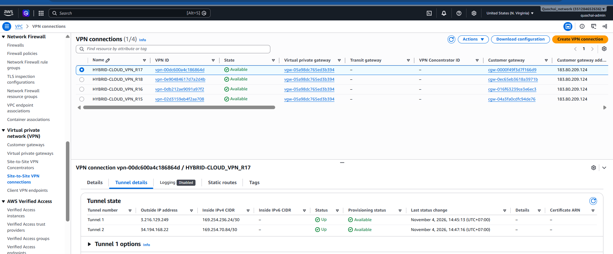
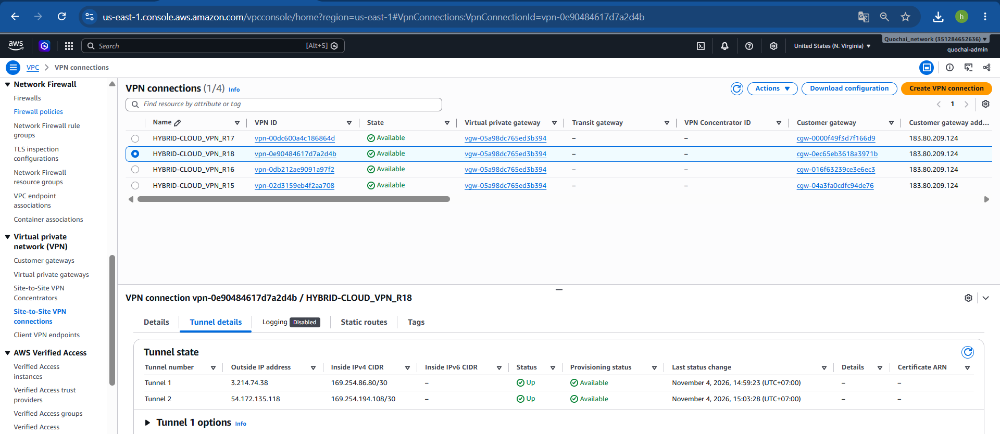
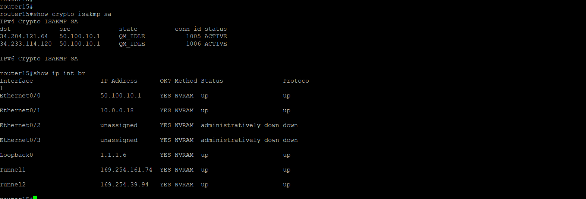
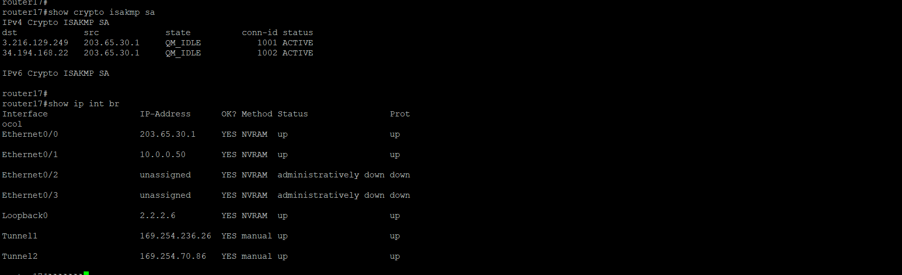


#### 4. Kiểm tra định tuyến và cơ chế dự phòng VPN

Kiểm tra hoạt động của đường VPN chính và dự phòng theo thiết kế định tuyến.

Kết quả mong đợi:

- Router15 đảm nhiệm đường VPN chính được ưu tiên.
- Router16 đảm nhiệm đường VPN dự phòng.
- Đường dự phòng được sử dụng khi đường chính gặp sự cố.
- Đường chính được ưu tiên trở lại sau khi khôi phục.

Kiểm tra trạng thái định tuyến và tracking:

```bash
show ip route 10.100.0.0
show track 100
show ip sla statistics
```

Thực hiện kiểm tra chuyển đổi dự phòng có kiểm soát:

1. Xác nhận đường VPN chính đang hoạt động.
2. Ghi nhận bảng định tuyến hiện tại.
3. Tạm thời vô hiệu hóa đường chính trong môi trường lab.
4. Kiểm tra cơ chế tracking có phát hiện sự cố hay không.
5. Xác nhận lưu lượng được chuyển sang đường dự phòng.
6. Khôi phục đường VPN chính.
7. Kiểm tra lại mức độ ưu tiên của route ban đầu.


**Hình 5.8.3: Kiểm tra định tuyến VPN chính và dự phòng**

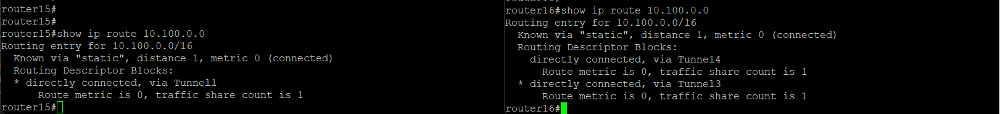

#### 5. Kiểm tra máy chủ Web trên EC2

Kiểm tra trạng thái hoạt động của EC2 Instance và Web Server.

Trên Ubuntu, kiểm tra dịch vụ Nginx:

```bash
sudo systemctl status nginx
```

Nếu Nginx chưa hoạt động, khởi động dịch vụ:

```bash
sudo systemctl start nginx
```

Kiểm tra Web Server đang lắng nghe trên cổng `80`:

```bash
sudo ss -tulpn | grep :80
```

Từ trình duyệt được cấp quyền truy cập, mở địa chỉ:

```text
http://44.203.161.19/
```

Xác nhận trang Web được hiển thị thành công.

Đồng thời, kiểm tra EC2 Instance đang ở trạng thái **Running** trong AWS EC2 Console.

**Hình 5.8.4: Kiểm tra trạng thái EC2 Instance**

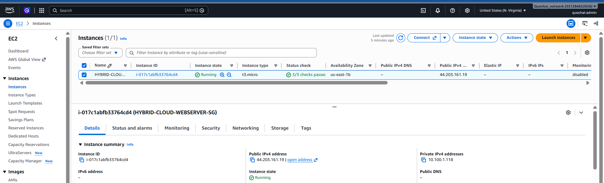

**Hình 5.8.5: Truy cập Web Server Nginx**

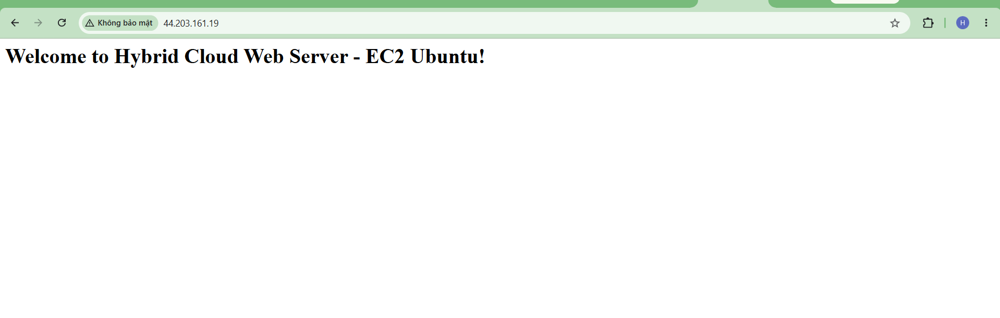

#### 6. Kiểm tra hệ thống giám sát tập trung

Kiểm tra trạng thái hoạt động của Node Exporter, Prometheus và Grafana trên máy chủ EC2.

Thực hiện các câu lệnh:

```bash
sudo systemctl status node_exporter
sudo systemctl status prometheus
sudo systemctl status grafana-server
```

Truy cập trang Prometheus Targets:

```text
http://<EC2_PUBLIC_IP>:9090/targets
```

Xác nhận hai target `prometheus` và `node_exporter` có trạng thái **UP**.

Tiếp theo, truy cập Grafana:

```text
http://<EC2_PUBLIC_IP>:3000
```

Kiểm tra Dashboard hiển thị các thông số tài nguyên máy chủ như:

- Mức sử dụng CPU.
- Mức sử dụng RAM.
- Dung lượng ổ đĩa.
- Lưu lượng mạng.

Xác nhận các biểu đồ nhận được dữ liệu cập nhật từ Prometheus.

**Hình 5.8.6: Kiểm tra Prometheus Targets**

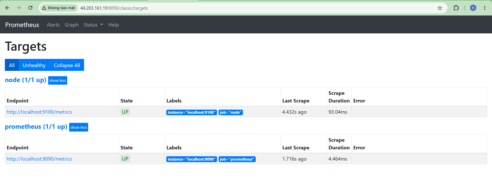

**Hình 5.8.7: Dashboard giám sát tập trung**

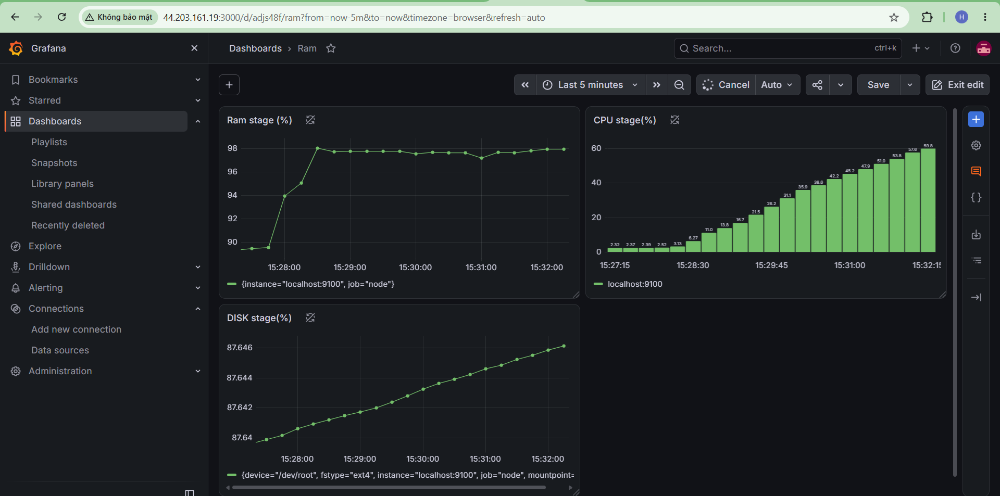


#### 7. Dọn dẹp các tài nguyên AWS không cần thiết


**EC2 Instance**

1. Truy cập EC2 Console.
2. Chọn **Instances**.
3. Chọn EC2 Instance sử dụng trong workshop.
4. Chọn **Instance state**.
5. Chọn **Terminate instance** .

**Customer gateways**

1. Mở mục **Customer gateways** trong vpc Console.
2. Chọn vào các customer gateway cần xóa.
3. Chọn action.
4. Chọn **delete custommer gateway**
5. Nhập vào chữ 'delete' và chọn delete để xóa.

**Site-to-Site VPN Resources**

1. Mở **Site-to-Site VPN Connections**.
2. Chọn vào các VPN cần xóa.
3. Chọn action.
4. Chọn **Delete VPN connection**.
5. Nhập vào chữ 'delete' và chọn delete để xóa.


#### 8. Đánh giá tổng thể hệ thống

Sau khi hoàn thành các bài kiểm tra, tiến hành đánh giá hoạt động tổng thể của hệ thống Hybrid Cloud.

Các nội dung đánh giá bao gồm:

- Khả năng kết nối giữa mạng nội bộ và AWS.
- Khả năng thiết lập và hoạt động của các VPN Tunnel Site-to-Site.
- Khả năng lựa chọn route chính và route dự phòng.
- Quá trình chuyển đổi và khôi phục kết nối VPN.
- Khả năng hoạt động của Web Server trên EC2.
- Khả năng thu thập dữ liệu máy chủ của Prometheus.
- Khả năng trực quan hóa dữ liệu giám sát trên Grafana.
- Quá trình rà soát và dọn dẹp các tài nguyên AWS không cần thiết.


#### Kết luận

Trong phần cuối cùng này, chúng ta đã kiểm tra hoạt động của hệ thống Hybrid Cloud kết nối mạng doanh nghiệp đa chi nhánh được mô phỏng trên EVE-NG với môi trường điện toán đám mây AWS.

Các bài kiểm tra bao gồm khả năng kết nối mạng, hoạt động của Site-to-Site VPN, định tuyến và chuyển đổi dự phòng, khả năng hoạt động của Web Server EC2 và hệ thống giám sát tập trung sử dụng Prometheus, Node Exporter và Grafana.

Đồng thời, chúng ta đã rà soát tài nguyên AWS và xác định những tài nguyên có thể dọn dẹp nhằm hạn chế chi phí không cần thiết.

Thông qua workshop này, chúng ta đã hoàn thành quá trình thiết kế, triển khai, giám sát và đánh giá giải pháp Hybrid Cloud kết nối mạng doanh nghiệp đa chi nhánh với AWS.
